# mojo-gemm: linear algebra kernels and linear algebra mapping in Mojo

I started this to evaluate [Mojo](https://mojolang.org): would it be
possible to port [ulmBLAS](https://github.com/michael-lehn/ulmBLAS), my
BLAS (Basic Linear Algebra Subprograms) and LAPACK (Linear Algebra
PACKage) implementation in C++, to Mojo?  After a day it turned into a bit
more.

In short (Apple M5, double precision; single precision gives the same
picture):

- [GEMM (general matrix-matrix multiply)](#1-experiments-with-porting-gemm)
  in Mojo is within a few percent of my C++ implementation ulmBLAS for
  large matrices.  Small matrices still need work.
- [A Cholesky
  factorization](#2-if-we-had-a-competitive-blas-could-we-provide-a-competitive-lapack)
  on top of it is faster than Apple Accelerate from n = 150 on (with a
  second core for the work around the SME (Scalable Matrix Extension) unit,
  which Accelerate does not use).  In place, for any storage order.  The one in numax is currently 10
  to 47 times slower (float and double), so this could go there.
- [Linear algebra mapping](#3-the-real-thing-to-solve-linear-algebra-mapping):
  my compiler ulm.lam, built on MLIR (Multi-Level Intermediate
  Representation), turns formulas as written in a paper into the code an
  expert would write.  For example, 8.1 times faster than the formula as
  written in Julia.  This is what I would like to bring to Mojo.

The details are in four parts:

1. [Experiments with porting GEMM (general matrix-matrix
   multiply)](#1-experiments-with-porting-gemm)\
   DGEMM (double precision GEMM) and SGEMM (single precision GEMM) with NEON
   and SME2 (Scalable Matrix Extension 2) micro kernels.
2. [If we had a competitive BLAS, could we provide a competitive
   LAPACK?](#2-if-we-had-a-competitive-blas-could-we-provide-a-competitive-lapack)\
   The Cholesky factorization in double and single precision, on our BLAS
   and on the BLAS of Apple Accelerate.
3. [The real thing to solve: linear algebra
   mapping](#3-the-real-thing-to-solve-linear-algebra-mapping)\
   This is why I got interested in MLIR (Multi-Level Intermediate
   Representation) and Mojo in the first place.
4. [Thoughts: what Mojo would need to enter the HPC (high performance
   computing) game](#4-thoughts-what-mojo-would-need-to-enter-the-hpc-game)\
   An infrastructure like BLIS (BLAS-like Library Instantiation Software),
   and a community around it.

## The linear algebra mapping problem in a nutshell

An application reads sensor data b and has to solve A x = b each time.
This is how one would like to write it, close to the algorithm:

```mojo
for l in range(steps):
    var b = get_sensor_data()
    var x = inv(A) * b
    react(x)
```

And this is what an expert writes, and what a compiler should generate:
the LU (lower-upper) factorization once, outside the loop, then
everything in place, with BLAS and LAPACK calls:

```mojo
var info = getrf(A, piv)        # P A = L U, once
if info != 0:
    return info
for l in range(steps):
    get_sensor_data(b)          # b in place
    laswp(b, piv)               # b <- P b
    trsv(Lower, Unit, A, b)     # b <- inv(L) b
    trsv(Upper, NonUnit, A, b)  # b <- inv(U) b
    react(b)
```

This translation is the LAMP (linear algebra mapping problem).  The
example is from my numerical linear algebra lectures.  It is just the
beginning: a compiler can choose the factorization from what is known
about A, the order of products, the hardware, the parallelization.
[Section 3](#3-the-real-thing-to-solve-linear-algebra-mapping) has more,
and what my compiler ulm.lam already does.

## 1. Experiments with porting GEMM

This was my first experiment with Mojo.  It is not a full port of the GEMM
in ulmBLAS.  It is roughly what my students implement in my course HPC1
(High Performance Computing 1).

The idea is simple and explained in my GEMM tutorial
[gemm-tutorial](https://github.com/michael-lehn/gemm-tutorial):

- exploit the cache hierarchy: packing of blocks of A and B, and a macro
  kernel that runs over the packed blocks;
- do the multiplication with the SIMD (single instruction, multiple data)
  features of the CPU (central processing unit): a micro kernel that keeps
  a small tile of C in registers.

The micro kernels are basically those of ulmBLAS:
[NEON](https://github.com/michael-lehn/ulmBLAS/blob/master/ulmblas/level3/ukernel/neon/ugemm.tcc)
(an 8 x 6 tile for double, 8 x 12 for float, here written in plain Mojo SIMD
code) and
[SME2 (Scalable Matrix Extension 2)](https://github.com/michael-lehn/ulmBLAS/blob/master/ulmblas/level3/ukernel/sme/ugemm.tcc)
(a 32 x 16 tile for double, 32 x 32 for float, here ported to inline
assembly).  For float, full panels that have to be transposed while packing
go through the ZA array (the matrix register of the SME unit): rows in,
columns out.

What is special: as in BLIS, the
matrices do not have to be stored column major.  Row major is fine, and so
are matrices whose rows and columns have an arbitrary (but constant) stride:
element (i, j) of A is `A[i*incRowA + j*incColA]`.  The micro kernels
write C fastest if it is column major; if C is closer to row major, the
driver computes C^T = B^T A^T instead.

Why GEMM is important:

- The performance of all BLAS level 3 functions (SYMM (symmetric
  matrix-matrix multiply), TRMM (triangular matrix-matrix multiply), TRSM
  (triangular solve with multiple right-hand sides), ...) depends on the platform specific micro kernel.
- The performance of LAPACK depends on the efficiency of the BLAS.

### Benchmarks with 64 bit floats (double precision)

C = A*B with m = n = k = 50, 100, ..., 4000, C row major, for the four
storage orders of A and B.  One thread on an Apple M5 (macOS 26.6),
Mojo 1.2.0.  For comparison: ulmBLAS (C++, commit
[4a0b610e](https://github.com/michael-lehn/ulmBLAS/commit/4a0b610e)) with
its NEON and SME2 micro kernels, and Apple Accelerate.  All implementations
are measured by the same program ([`bench.mojo`](bench.mojo)); every result
is checked.

For large matrices Mojo is close to ulmBLAS: for n >= 500 it reaches
98 to 100% of ulmBLAS with NEON and 92 to 98% with SME2.  For small
matrices SME2 is still behind: 77 to 89% of ulmBLAS at n = 250,
52 to 62% at n = 100.  The SME2 unit computes so fast that everything
around the micro kernel matters.  Since the first version, the macro kernel
runs in streaming mode (one mode switch per call of the macro kernel instead
of one per tile), partial tiles are handled with predicates, and partial
panels are packed with SIMD instructions.  ulmBLAS also packs A and B in
streaming mode.  Small matrices simply need special treatment.  That is why
I am currently optimizing ulmBLAS for smaller dimensions.

#### A row major, B row major

<picture>
  <source media="(prefers-color-scheme: dark)" srcset="results/A-row_B-row/gflops-dark.svg">
  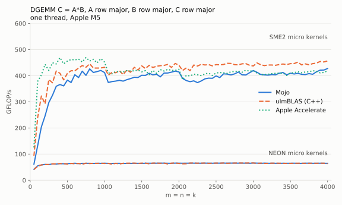
</picture>

<details>
<summary>Mojo: time and GFLOP/s (giga floating-point operations per second)</summary>

| m = n = k | NEON: time (s) | NEON: GFLOP/s | SME2: time (s) | SME2: GFLOP/s |
|---:|---:|---:|---:|---:|
| 50 | 5.969e-06 | 41.9 | 4.075e-06 | 61.3 |
| 100 | 3.645e-05 | 54.9 | 1.518e-05 | 131.7 |
| 150 | 1.154e-04 | 58.5 | 3.312e-05 | 203.8 |
| 200 | 2.644e-04 | 60.5 | 6.498e-05 | 246.2 |
| 250 | 5.243e-04 | 59.6 | 1.052e-04 | 297.1 |
| 300 | 8.649e-04 | 62.4 | 1.661e-04 | 325.2 |
| 350 | 1.388e-03 | 61.8 | 2.386e-04 | 359.4 |
| 400 | 2.011e-03 | 63.6 | 3.495e-04 | 366.2 |
| 450 | 2.900e-03 | 62.8 | 5.051e-04 | 360.8 |
| 500 | 3.932e-03 | 63.6 | 6.527e-04 | 383.0 |
| 550 | 5.209e-03 | 63.9 | 8.904e-04 | 373.7 |
| 600 | 6.656e-03 | 64.9 | 1.070e-03 | 403.7 |
| 650 | 8.627e-03 | 63.7 | 1.398e-03 | 392.8 |
| 700 | 1.064e-02 | 64.5 | 1.644e-03 | 417.2 |
| 750 | 1.307e-02 | 64.5 | 2.103e-03 | 401.3 |
| 800 | 1.585e-02 | 64.6 | 2.404e-03 | 425.9 |
| 850 | 1.915e-02 | 64.1 | 2.979e-03 | 412.2 |
| 900 | 2.251e-02 | 64.8 | 3.507e-03 | 415.8 |
| 950 | 2.661e-02 | 64.4 | 4.084e-03 | 419.9 |
| 1000 | 3.073e-02 | 65.1 | 4.855e-03 | 411.9 |
| 1050 | 3.600e-02 | 64.3 | 6.193e-03 | 373.9 |
| 1100 | 4.140e-02 | 64.3 | 7.054e-03 | 377.4 |
| 1150 | 4.717e-02 | 64.5 | 8.019e-03 | 379.3 |
| 1200 | 5.350e-02 | 64.6 | 9.041e-03 | 382.3 |
| 1250 | 6.105e-02 | 64.0 | 1.030e-02 | 379.1 |
| 1300 | 6.816e-02 | 64.5 | 1.142e-02 | 384.7 |
| 1350 | 7.651e-02 | 64.3 | 1.265e-02 | 388.9 |
| 1400 | 8.488e-02 | 64.7 | 1.393e-02 | 393.9 |
| 1450 | 9.442e-02 | 64.6 | 1.551e-02 | 393.1 |
| 1500 | 1.049e-01 | 64.3 | 1.681e-02 | 401.5 |
| 1550 | 1.148e-01 | 64.9 | 1.857e-02 | 401.1 |
| 1600 | 1.263e-01 | 64.9 | 2.002e-02 | 409.1 |
| 1650 | 1.387e-01 | 64.8 | 2.227e-02 | 403.4 |
| 1700 | 1.512e-01 | 65.0 | 2.423e-02 | 405.6 |
| 1750 | 1.645e-01 | 65.2 | 2.711e-02 | 395.4 |
| 1800 | 1.788e-01 | 65.2 | 2.845e-02 | 410.0 |
| 1850 | 1.954e-01 | 64.8 | 3.087e-02 | 410.2 |
| 1900 | 2.123e-01 | 64.6 | 3.318e-02 | 413.5 |
| 1950 | 2.271e-01 | 65.3 | 3.553e-02 | 417.4 |
| 2000 | 2.460e-01 | 65.0 | 3.861e-02 | 414.4 |
| 2050 | 2.655e-01 | 64.9 | 4.426e-02 | 389.3 |
| 2100 | 2.845e-01 | 65.1 | 4.858e-02 | 381.3 |
| 2150 | 3.054e-01 | 65.1 | 5.273e-02 | 377.0 |
| 2200 | 3.269e-01 | 65.2 | 5.601e-02 | 380.2 |
| 2250 | 3.512e-01 | 64.9 | 6.101e-02 | 373.4 |
| 2300 | 3.753e-01 | 64.8 | 6.408e-02 | 379.8 |
| 2350 | 3.979e-01 | 65.2 | 6.692e-02 | 387.8 |
| 2400 | 4.248e-01 | 65.1 | 7.080e-02 | 390.5 |
| 2450 | 4.528e-01 | 65.0 | 7.544e-02 | 389.9 |
| 2500 | 4.805e-01 | 65.0 | 7.833e-02 | 399.0 |
| 2550 | 5.083e-01 | 65.2 | 8.446e-02 | 392.7 |
| 2600 | 5.382e-01 | 65.3 | 8.636e-02 | 407.0 |
| 2650 | 5.708e-01 | 65.2 | 9.168e-02 | 406.0 |
| 2700 | 6.027e-01 | 65.3 | 9.767e-02 | 403.0 |
| 2750 | 6.371e-01 | 65.3 | 1.022e-01 | 406.9 |
| 2800 | 6.731e-01 | 65.2 | 1.060e-01 | 414.1 |
| 2850 | 7.102e-01 | 65.2 | 1.148e-01 | 403.3 |
| 2900 | 7.480e-01 | 65.2 | 1.211e-01 | 402.7 |
| 2950 | 7.933e-01 | 64.7 | 1.249e-01 | 411.2 |
| 3000 | 8.248e-01 | 65.5 | 1.287e-01 | 419.5 |
| 3050 | 8.687e-01 | 65.3 | 1.374e-01 | 413.0 |
| 3100 | 9.261e-01 | 64.3 | 1.472e-01 | 404.9 |
| 3150 | 9.563e-01 | 65.4 | 1.551e-01 | 403.1 |
| 3200 | 1.012e+00 | 64.7 | 1.630e-01 | 402.1 |
| 3250 | 1.059e+00 | 64.8 | 1.698e-01 | 404.3 |
| 3300 | 1.112e+00 | 64.7 | 1.782e-01 | 403.4 |
| 3350 | 1.167e+00 | 64.5 | 1.837e-01 | 409.3 |
| 3400 | 1.212e+00 | 64.9 | 1.907e-01 | 412.1 |
| 3450 | 1.269e+00 | 64.7 | 2.036e-01 | 403.4 |
| 3500 | 1.324e+00 | 64.8 | 2.094e-01 | 409.4 |
| 3550 | 1.377e+00 | 65.0 | 2.202e-01 | 406.4 |
| 3600 | 1.450e+00 | 64.3 | 2.282e-01 | 408.9 |
| 3650 | 1.507e+00 | 64.5 | 2.400e-01 | 405.2 |
| 3700 | 1.559e+00 | 65.0 | 2.505e-01 | 404.4 |
| 3750 | 1.621e+00 | 65.1 | 2.586e-01 | 407.8 |
| 3800 | 1.698e+00 | 64.6 | 2.707e-01 | 405.4 |
| 3850 | 1.762e+00 | 64.8 | 2.751e-01 | 414.8 |
| 3900 | 1.828e+00 | 64.9 | 2.817e-01 | 421.2 |
| 3950 | 1.904e+00 | 64.7 | 2.924e-01 | 421.5 |
| 4000 | 1.983e+00 | 64.6 | 2.995e-01 | 427.4 |

</details>

#### A row major, B column major

<picture>
  <source media="(prefers-color-scheme: dark)" srcset="results/A-row_B-col/gflops-dark.svg">
  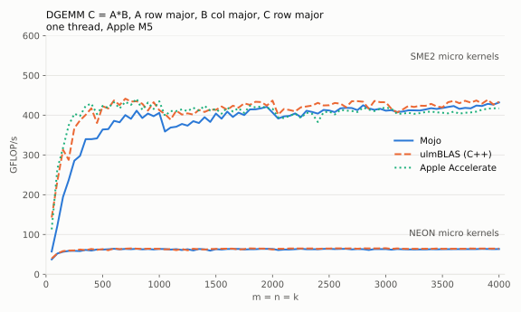
</picture>

<details>
<summary>Mojo: time and GFLOP/s (giga floating-point operations per second)</summary>

| m = n = k | NEON: time (s) | NEON: GFLOP/s | SME2: time (s) | SME2: GFLOP/s |
|---:|---:|---:|---:|---:|
| 50 | 6.680e-06 | 37.4 | 4.370e-06 | 57.2 |
| 100 | 3.836e-05 | 52.1 | 1.639e-05 | 122.1 |
| 150 | 1.195e-04 | 56.5 | 3.471e-05 | 194.5 |
| 200 | 2.727e-04 | 58.7 | 6.762e-05 | 236.6 |
| 250 | 5.311e-04 | 58.8 | 1.094e-04 | 285.6 |
| 300 | 9.260e-04 | 58.3 | 1.814e-04 | 297.7 |
| 350 | 1.400e-03 | 61.2 | 2.525e-04 | 339.7 |
| 400 | 2.149e-03 | 59.6 | 3.768e-04 | 339.7 |
| 450 | 2.924e-03 | 62.3 | 5.334e-04 | 341.7 |
| 500 | 4.030e-03 | 62.0 | 6.869e-04 | 364.0 |
| 550 | 5.292e-03 | 62.9 | 9.118e-04 | 365.0 |
| 600 | 6.741e-03 | 64.1 | 1.120e-03 | 385.7 |
| 650 | 8.757e-03 | 62.7 | 1.437e-03 | 382.1 |
| 700 | 1.077e-02 | 63.7 | 1.714e-03 | 400.2 |
| 750 | 1.338e-02 | 63.1 | 2.159e-03 | 390.9 |
| 800 | 1.599e-02 | 64.0 | 2.490e-03 | 411.3 |
| 850 | 1.959e-02 | 62.7 | 3.126e-03 | 392.9 |
| 900 | 2.296e-02 | 63.5 | 3.608e-03 | 404.1 |
| 950 | 2.748e-02 | 62.4 | 4.314e-03 | 397.5 |
| 1000 | 3.139e-02 | 63.7 | 4.929e-03 | 405.8 |
| 1050 | 3.652e-02 | 63.4 | 6.452e-03 | 358.8 |
| 1100 | 4.287e-02 | 62.1 | 7.216e-03 | 368.9 |
| 1150 | 4.818e-02 | 63.1 | 8.200e-03 | 370.9 |
| 1200 | 5.662e-02 | 61.0 | 9.145e-03 | 377.9 |
| 1250 | 6.205e-02 | 62.9 | 1.045e-02 | 373.7 |
| 1300 | 7.331e-02 | 59.9 | 1.142e-02 | 384.9 |
| 1350 | 7.744e-02 | 63.5 | 1.294e-02 | 380.3 |
| 1400 | 8.748e-02 | 62.7 | 1.390e-02 | 394.9 |
| 1450 | 1.026e-01 | 59.4 | 1.592e-02 | 383.0 |
| 1500 | 1.069e-01 | 63.2 | 1.671e-02 | 404.0 |
| 1550 | 1.199e-01 | 62.1 | 1.904e-02 | 391.2 |
| 1600 | 1.289e-01 | 63.5 | 2.003e-02 | 408.9 |
| 1650 | 1.411e-01 | 63.7 | 2.272e-02 | 395.5 |
| 1700 | 1.542e-01 | 63.7 | 2.418e-02 | 406.3 |
| 1750 | 1.721e-01 | 62.3 | 2.678e-02 | 400.2 |
| 1800 | 1.853e-01 | 62.9 | 2.814e-02 | 414.4 |
| 1850 | 2.010e-01 | 63.0 | 3.053e-02 | 414.7 |
| 1900 | 2.146e-01 | 63.9 | 3.287e-02 | 417.3 |
| 1950 | 2.323e-01 | 63.8 | 3.522e-02 | 421.0 |
| 2000 | 2.512e-01 | 63.7 | 3.936e-02 | 406.5 |
| 2050 | 2.828e-01 | 60.9 | 4.401e-02 | 391.5 |
| 2100 | 2.982e-01 | 62.1 | 4.666e-02 | 397.0 |
| 2150 | 3.194e-01 | 62.2 | 4.991e-02 | 398.3 |
| 2200 | 3.379e-01 | 63.0 | 5.266e-02 | 404.4 |
| 2250 | 3.555e-01 | 64.1 | 5.764e-02 | 395.3 |
| 2300 | 3.868e-01 | 62.9 | 5.920e-02 | 411.1 |
| 2350 | 4.124e-01 | 62.9 | 6.361e-02 | 408.1 |
| 2400 | 4.403e-01 | 62.8 | 6.844e-02 | 404.0 |
| 2450 | 4.612e-01 | 63.8 | 7.118e-02 | 413.2 |
| 2500 | 4.893e-01 | 63.9 | 7.589e-02 | 411.8 |
| 2550 | 5.235e-01 | 63.3 | 8.135e-02 | 407.7 |
| 2600 | 5.514e-01 | 63.8 | 8.425e-02 | 417.3 |
| 2650 | 5.817e-01 | 64.0 | 8.896e-02 | 418.4 |
| 2700 | 6.292e-01 | 62.6 | 9.419e-02 | 418.0 |
| 2750 | 6.566e-01 | 63.3 | 1.008e-01 | 412.6 |
| 2800 | 6.959e-01 | 63.1 | 1.033e-01 | 424.9 |
| 2850 | 7.578e-01 | 61.1 | 1.110e-01 | 417.0 |
| 2900 | 7.707e-01 | 63.3 | 1.180e-01 | 413.5 |
| 2950 | 8.118e-01 | 63.2 | 1.234e-01 | 416.1 |
| 3000 | 8.530e-01 | 63.3 | 1.313e-01 | 411.3 |
| 3050 | 9.182e-01 | 61.8 | 1.376e-01 | 412.5 |
| 3100 | 9.406e-01 | 63.3 | 1.461e-01 | 407.9 |
| 3150 | 9.951e-01 | 62.8 | 1.528e-01 | 409.1 |
| 3200 | 1.049e+00 | 62.5 | 1.590e-01 | 412.2 |
| 3250 | 1.101e+00 | 62.4 | 1.666e-01 | 412.2 |
| 3300 | 1.151e+00 | 62.4 | 1.746e-01 | 411.7 |
| 3350 | 1.204e+00 | 62.4 | 1.815e-01 | 414.3 |
| 3400 | 1.247e+00 | 63.0 | 1.883e-01 | 417.5 |
| 3450 | 1.310e+00 | 62.7 | 1.976e-01 | 415.6 |
| 3500 | 1.361e+00 | 63.0 | 2.051e-01 | 418.0 |
| 3550 | 1.419e+00 | 63.0 | 2.127e-01 | 420.6 |
| 3600 | 1.477e+00 | 63.2 | 2.206e-01 | 423.0 |
| 3650 | 1.537e+00 | 63.3 | 2.338e-01 | 415.9 |
| 3700 | 1.603e+00 | 63.2 | 2.422e-01 | 418.3 |
| 3750 | 1.669e+00 | 63.2 | 2.528e-01 | 417.2 |
| 3800 | 1.734e+00 | 63.3 | 2.587e-01 | 424.2 |
| 3850 | 1.790e+00 | 63.8 | 2.698e-01 | 423.1 |
| 3900 | 1.868e+00 | 63.5 | 2.769e-01 | 428.4 |
| 3950 | 1.952e+00 | 63.2 | 2.890e-01 | 426.6 |
| 4000 | 2.018e+00 | 63.4 | 2.964e-01 | 431.8 |

</details>

#### A column major, B row major

<picture>
  <source media="(prefers-color-scheme: dark)" srcset="results/A-col_B-row/gflops-dark.svg">
  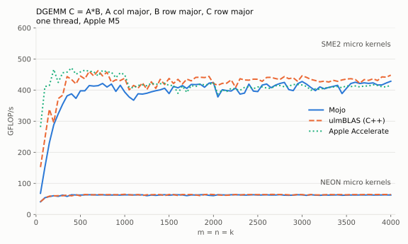
</picture>

<details>
<summary>Mojo: time and GFLOP/s (giga floating-point operations per second)</summary>

| m = n = k | NEON: time (s) | NEON: GFLOP/s | SME2: time (s) | SME2: GFLOP/s |
|---:|---:|---:|---:|---:|
| 50 | 6.130e-06 | 40.8 | 3.667e-06 | 68.2 |
| 100 | 3.709e-05 | 53.9 | 1.311e-05 | 152.5 |
| 150 | 1.170e-04 | 57.7 | 2.930e-05 | 230.4 |
| 200 | 2.655e-04 | 60.3 | 5.544e-05 | 288.6 |
| 250 | 5.358e-04 | 58.3 | 9.660e-05 | 323.5 |
| 300 | 8.655e-04 | 62.4 | 1.523e-04 | 354.6 |
| 350 | 1.474e-03 | 58.2 | 2.249e-04 | 381.4 |
| 400 | 2.021e-03 | 63.3 | 3.300e-04 | 387.9 |
| 450 | 2.903e-03 | 62.8 | 4.883e-04 | 373.2 |
| 500 | 4.007e-03 | 62.4 | 6.288e-04 | 397.6 |
| 550 | 5.282e-03 | 63.0 | 8.369e-04 | 397.6 |
| 600 | 6.814e-03 | 63.4 | 1.042e-03 | 414.5 |
| 650 | 8.706e-03 | 63.1 | 1.330e-03 | 412.8 |
| 700 | 1.095e-02 | 62.6 | 1.656e-03 | 414.1 |
| 750 | 1.331e-02 | 63.4 | 2.003e-03 | 421.2 |
| 800 | 1.642e-02 | 62.3 | 2.499e-03 | 409.7 |
| 850 | 1.960e-02 | 62.7 | 2.929e-03 | 419.3 |
| 900 | 2.324e-02 | 62.7 | 3.685e-03 | 395.7 |
| 950 | 2.748e-02 | 62.4 | 4.128e-03 | 415.4 |
| 1000 | 3.178e-02 | 62.9 | 5.081e-03 | 393.6 |
| 1050 | 3.668e-02 | 63.1 | 6.129e-03 | 377.7 |
| 1100 | 4.237e-02 | 62.8 | 7.246e-03 | 367.4 |
| 1150 | 4.825e-02 | 63.0 | 7.838e-03 | 388.1 |
| 1200 | 5.471e-02 | 63.2 | 8.929e-03 | 387.0 |
| 1250 | 6.468e-02 | 60.4 | 1.002e-02 | 389.8 |
| 1300 | 7.022e-02 | 62.6 | 1.114e-02 | 394.3 |
| 1350 | 8.005e-02 | 61.5 | 1.237e-02 | 397.9 |
| 1400 | 8.762e-02 | 62.6 | 1.370e-02 | 400.7 |
| 1450 | 9.598e-02 | 63.5 | 1.502e-02 | 405.9 |
| 1500 | 1.091e-01 | 61.9 | 1.736e-02 | 388.7 |
| 1550 | 1.177e-01 | 63.3 | 1.808e-02 | 412.0 |
| 1600 | 1.293e-01 | 63.3 | 2.012e-02 | 407.2 |
| 1650 | 1.430e-01 | 62.8 | 2.168e-02 | 414.4 |
| 1700 | 1.622e-01 | 60.6 | 2.424e-02 | 405.3 |
| 1750 | 1.707e-01 | 62.8 | 2.563e-02 | 418.1 |
| 1800 | 1.862e-01 | 62.6 | 2.793e-02 | 417.6 |
| 1850 | 2.002e-01 | 63.3 | 3.022e-02 | 419.0 |
| 1900 | 2.154e-01 | 63.7 | 3.354e-02 | 409.0 |
| 1950 | 2.405e-01 | 61.7 | 3.512e-02 | 422.2 |
| 2000 | 2.639e-01 | 60.6 | 3.771e-02 | 424.2 |
| 2050 | 2.716e-01 | 63.4 | 4.561e-02 | 377.8 |
| 2100 | 2.942e-01 | 63.0 | 4.618e-02 | 401.0 |
| 2150 | 3.171e-01 | 62.7 | 4.989e-02 | 398.4 |
| 2200 | 3.363e-01 | 63.3 | 5.365e-02 | 396.9 |
| 2250 | 3.595e-01 | 63.4 | 5.602e-02 | 406.7 |
| 2300 | 3.855e-01 | 63.1 | 6.288e-02 | 387.0 |
| 2350 | 4.164e-01 | 62.3 | 6.652e-02 | 390.2 |
| 2400 | 4.413e-01 | 62.7 | 6.596e-02 | 419.2 |
| 2450 | 4.639e-01 | 63.4 | 7.415e-02 | 396.7 |
| 2500 | 4.994e-01 | 62.6 | 7.908e-02 | 395.1 |
| 2550 | 5.288e-01 | 62.7 | 7.972e-02 | 416.0 |
| 2600 | 5.558e-01 | 63.2 | 8.380e-02 | 419.5 |
| 2650 | 5.966e-01 | 62.4 | 9.133e-02 | 407.5 |
| 2700 | 6.286e-01 | 62.6 | 9.466e-02 | 415.9 |
| 2750 | 6.546e-01 | 63.5 | 9.875e-02 | 421.2 |
| 2800 | 7.071e-01 | 62.1 | 1.034e-01 | 424.7 |
| 2850 | 7.500e-01 | 61.7 | 1.153e-01 | 401.4 |
| 2900 | 7.825e-01 | 62.3 | 1.225e-01 | 398.2 |
| 2950 | 8.094e-01 | 63.4 | 1.221e-01 | 420.5 |
| 3000 | 8.575e-01 | 63.0 | 1.263e-01 | 427.6 |
| 3050 | 9.215e-01 | 61.6 | 1.354e-01 | 419.1 |
| 3100 | 9.381e-01 | 63.5 | 1.460e-01 | 408.0 |
| 3150 | 1.005e+00 | 62.2 | 1.570e-01 | 398.2 |
| 3200 | 1.062e+00 | 61.7 | 1.597e-01 | 410.3 |
| 3250 | 1.094e+00 | 62.7 | 1.699e-01 | 404.0 |
| 3300 | 1.154e+00 | 62.3 | 1.759e-01 | 408.6 |
| 3350 | 1.203e+00 | 62.5 | 1.826e-01 | 411.8 |
| 3400 | 1.246e+00 | 63.1 | 1.893e-01 | 415.4 |
| 3450 | 1.329e+00 | 61.8 | 2.113e-01 | 388.7 |
| 3500 | 1.378e+00 | 62.2 | 2.114e-01 | 405.6 |
| 3550 | 1.429e+00 | 62.6 | 2.124e-01 | 421.2 |
| 3600 | 1.494e+00 | 62.5 | 2.195e-01 | 425.2 |
| 3650 | 1.549e+00 | 62.8 | 2.309e-01 | 421.1 |
| 3700 | 1.620e+00 | 62.5 | 2.393e-01 | 423.3 |
| 3750 | 1.678e+00 | 62.9 | 2.502e-01 | 421.5 |
| 3800 | 1.755e+00 | 62.5 | 2.594e-01 | 423.2 |
| 3850 | 1.828e+00 | 62.4 | 2.741e-01 | 416.4 |
| 3900 | 1.888e+00 | 62.8 | 2.848e-01 | 416.6 |
| 3950 | 1.961e+00 | 62.8 | 2.914e-01 | 422.9 |
| 4000 | 2.045e+00 | 62.6 | 2.989e-01 | 428.3 |

</details>

#### A column major, B column major

<picture>
  <source media="(prefers-color-scheme: dark)" srcset="results/A-col_B-col/gflops-dark.svg">
  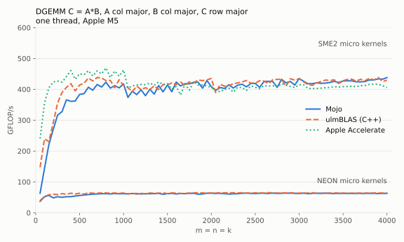
</picture>

<details>
<summary>Mojo: time and GFLOP/s (giga floating-point operations per second)</summary>

| m = n = k | NEON: time (s) | NEON: GFLOP/s | SME2: time (s) | SME2: GFLOP/s |
|---:|---:|---:|---:|---:|
| 50 | 6.743e-06 | 37.1 | 3.957e-06 | 63.2 |
| 100 | 3.867e-05 | 51.7 | 1.395e-05 | 143.4 |
| 150 | 1.198e-04 | 56.4 | 3.057e-05 | 220.8 |
| 200 | 3.324e-04 | 48.1 | 5.918e-05 | 270.4 |
| 250 | 6.007e-04 | 52.0 | 9.867e-05 | 316.7 |
| 300 | 1.082e-03 | 49.9 | 1.648e-04 | 327.7 |
| 350 | 1.649e-03 | 52.0 | 2.344e-04 | 365.9 |
| 400 | 2.459e-03 | 52.0 | 3.544e-04 | 361.1 |
| 450 | 3.371e-03 | 54.1 | 5.034e-04 | 362.1 |
| 500 | 4.474e-03 | 55.9 | 6.517e-04 | 383.6 |
| 550 | 5.795e-03 | 57.4 | 8.625e-04 | 385.8 |
| 600 | 7.347e-03 | 58.8 | 1.062e-03 | 406.9 |
| 650 | 9.120e-03 | 60.2 | 1.383e-03 | 397.0 |
| 700 | 1.129e-02 | 60.8 | 1.650e-03 | 415.8 |
| 750 | 1.369e-02 | 61.6 | 2.071e-03 | 407.4 |
| 800 | 1.661e-02 | 61.7 | 2.419e-03 | 423.3 |
| 850 | 2.015e-02 | 61.0 | 3.041e-03 | 403.9 |
| 900 | 2.350e-02 | 62.1 | 3.539e-03 | 412.0 |
| 950 | 2.796e-02 | 61.3 | 4.238e-03 | 404.6 |
| 1000 | 3.236e-02 | 61.8 | 4.788e-03 | 417.7 |
| 1050 | 3.778e-02 | 61.3 | 6.195e-03 | 373.7 |
| 1100 | 4.284e-02 | 62.1 | 6.763e-03 | 393.6 |
| 1150 | 4.883e-02 | 62.3 | 7.948e-03 | 382.7 |
| 1200 | 5.684e-02 | 60.8 | 8.673e-03 | 398.5 |
| 1250 | 6.325e-02 | 61.8 | 1.030e-02 | 379.2 |
| 1300 | 7.144e-02 | 61.5 | 1.098e-02 | 400.3 |
| 1350 | 7.938e-02 | 62.0 | 1.280e-02 | 384.5 |
| 1400 | 8.752e-02 | 62.7 | 1.331e-02 | 412.3 |
| 1450 | 1.020e-01 | 59.8 | 1.557e-02 | 391.7 |
| 1500 | 1.090e-01 | 61.9 | 1.629e-02 | 414.3 |
| 1550 | 1.187e-01 | 62.7 | 1.899e-02 | 392.1 |
| 1600 | 1.346e-01 | 60.9 | 1.934e-02 | 423.7 |
| 1650 | 1.445e-01 | 62.2 | 2.186e-02 | 410.9 |
| 1700 | 1.590e-01 | 61.8 | 2.349e-02 | 418.2 |
| 1750 | 1.702e-01 | 63.0 | 2.565e-02 | 417.8 |
| 1800 | 1.853e-01 | 63.0 | 2.758e-02 | 423.0 |
| 1850 | 2.111e-01 | 60.0 | 2.994e-02 | 423.0 |
| 1900 | 2.255e-01 | 60.8 | 3.398e-02 | 403.7 |
| 1950 | 2.341e-01 | 63.3 | 3.460e-02 | 428.6 |
| 2000 | 2.522e-01 | 63.4 | 3.917e-02 | 408.4 |
| 2050 | 2.757e-01 | 62.5 | 4.345e-02 | 396.6 |
| 2100 | 2.953e-01 | 62.7 | 4.562e-02 | 406.0 |
| 2150 | 3.206e-01 | 62.0 | 4.934e-02 | 402.8 |
| 2200 | 3.525e-01 | 60.4 | 5.131e-02 | 415.1 |
| 2250 | 3.712e-01 | 61.4 | 5.637e-02 | 404.1 |
| 2300 | 3.945e-01 | 61.7 | 5.885e-02 | 413.5 |
| 2350 | 4.119e-01 | 63.0 | 6.231e-02 | 416.6 |
| 2400 | 4.347e-01 | 63.6 | 6.776e-02 | 408.1 |
| 2450 | 4.686e-01 | 62.8 | 7.020e-02 | 419.0 |
| 2500 | 5.030e-01 | 62.1 | 7.456e-02 | 419.1 |
| 2550 | 5.246e-01 | 63.2 | 8.161e-02 | 406.3 |
| 2600 | 5.559e-01 | 63.2 | 8.263e-02 | 425.4 |
| 2650 | 5.959e-01 | 62.5 | 8.737e-02 | 426.0 |
| 2700 | 6.189e-01 | 63.6 | 9.260e-02 | 425.1 |
| 2750 | 6.660e-01 | 62.4 | 1.023e-01 | 406.8 |
| 2800 | 6.951e-01 | 63.2 | 1.016e-01 | 432.2 |
| 2850 | 7.297e-01 | 63.4 | 1.099e-01 | 421.2 |
| 2900 | 7.699e-01 | 63.4 | 1.147e-01 | 425.4 |
| 2950 | 8.166e-01 | 62.9 | 1.241e-01 | 413.7 |
| 3000 | 8.669e-01 | 62.3 | 1.241e-01 | 435.1 |
| 3050 | 8.931e-01 | 63.5 | 1.331e-01 | 426.2 |
| 3100 | 9.679e-01 | 61.6 | 1.425e-01 | 418.2 |
| 3150 | 9.929e-01 | 63.0 | 1.494e-01 | 418.4 |
| 3200 | 1.037e+00 | 63.2 | 1.557e-01 | 421.0 |
| 3250 | 1.087e+00 | 63.2 | 1.637e-01 | 419.4 |
| 3300 | 1.132e+00 | 63.5 | 1.711e-01 | 420.1 |
| 3350 | 1.198e+00 | 62.8 | 1.781e-01 | 422.3 |
| 3400 | 1.263e+00 | 62.2 | 1.846e-01 | 425.8 |
| 3450 | 1.307e+00 | 62.8 | 1.945e-01 | 422.2 |
| 3500 | 1.370e+00 | 62.6 | 2.008e-01 | 426.9 |
| 3550 | 1.425e+00 | 62.8 | 2.091e-01 | 427.9 |
| 3600 | 1.495e+00 | 62.4 | 2.184e-01 | 427.2 |
| 3650 | 1.548e+00 | 62.8 | 2.291e-01 | 424.4 |
| 3700 | 1.616e+00 | 62.7 | 2.388e-01 | 424.2 |
| 3750 | 1.683e+00 | 62.7 | 2.480e-01 | 425.3 |
| 3800 | 1.745e+00 | 62.9 | 2.550e-01 | 430.4 |
| 3850 | 1.818e+00 | 62.8 | 2.653e-01 | 430.3 |
| 3900 | 1.911e+00 | 62.1 | 2.734e-01 | 434.0 |
| 3950 | 1.966e+00 | 62.7 | 2.848e-01 | 432.8 |
| 4000 | 2.036e+00 | 62.9 | 2.921e-01 | 438.2 |

</details>

### Benchmarks with 32 bit floats (single precision)

The same for SGEMM: the same sizes, storage orders and libraries, measured
with `./bench --float`.  The float kernels of ulmBLAS have the same tile
sizes as the ones here.

For large matrices the picture is the same as for double: for n >= 500 Mojo
reaches 88 to 103% of ulmBLAS with NEON and 86 to 110% with SME2.  Accelerate
is a bit faster for float: for n >= 1000 Mojo with SME2 reaches on average
88 to 99% of Accelerate, depending on the storage orders.  Small matrices are
again the open part: 70 to 83% of ulmBLAS at n = 250, 55 to 78% at n = 100.
With NEON, Mojo is on par with ulmBLAS also for small matrices.

#### A row major, B row major

<picture>
  <source media="(prefers-color-scheme: dark)" srcset="results-float/A-row_B-row/gflops-dark.svg">
  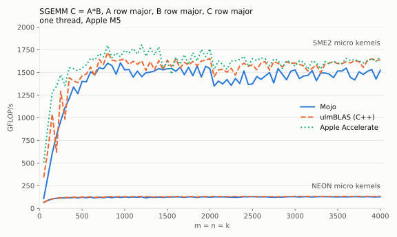
</picture>

<details>
<summary>Mojo: time and GFLOP/s</summary>

| m = n = k | NEON: time (s) | NEON: GFLOP/s | SME2: time (s) | SME2: GFLOP/s |
|---:|---:|---:|---:|---:|
| 50 | 3.764e-06 | 66.4 | 2.295e-06 | 108.9 |
| 100 | 2.251e-05 | 88.8 | 5.596e-06 | 357.4 |
| 150 | 6.443e-05 | 104.8 | 1.107e-05 | 609.5 |
| 200 | 1.446e-04 | 110.7 | 1.986e-05 | 805.6 |
| 250 | 2.748e-04 | 113.7 | 3.239e-05 | 964.9 |
| 300 | 4.681e-04 | 115.4 | 4.866e-05 | 1109.8 |
| 350 | 7.391e-04 | 116.0 | 7.067e-05 | 1213.4 |
| 400 | 1.066e-03 | 120.0 | 9.560e-05 | 1338.9 |
| 450 | 1.565e-03 | 116.5 | 1.441e-04 | 1264.5 |
| 500 | 2.048e-03 | 122.0 | 1.784e-04 | 1401.0 |
| 550 | 2.835e-03 | 117.4 | 2.384e-04 | 1395.6 |
| 600 | 3.512e-03 | 123.0 | 2.868e-04 | 1506.1 |
| 650 | 4.781e-03 | 114.9 | 3.725e-04 | 1474.5 |
| 700 | 5.602e-03 | 122.5 | 4.423e-04 | 1551.1 |
| 750 | 7.250e-03 | 116.4 | 5.483e-04 | 1538.9 |
| 800 | 8.161e-03 | 125.5 | 6.399e-04 | 1600.2 |
| 850 | 1.046e-02 | 117.4 | 7.798e-04 | 1575.0 |
| 900 | 1.160e-02 | 125.7 | 9.855e-04 | 1479.5 |
| 950 | 1.421e-02 | 120.7 | 1.069e-03 | 1604.6 |
| 1000 | 1.587e-02 | 126.0 | 1.309e-03 | 1528.0 |
| 1050 | 1.893e-02 | 122.3 | 1.511e-03 | 1532.2 |
| 1100 | 2.126e-02 | 125.2 | 1.840e-03 | 1447.1 |
| 1150 | 2.483e-02 | 122.5 | 2.009e-03 | 1514.3 |
| 1200 | 2.728e-02 | 126.7 | 2.379e-03 | 1452.7 |
| 1250 | 3.395e-02 | 115.1 | 2.612e-03 | 1495.7 |
| 1300 | 3.531e-02 | 124.4 | 2.924e-03 | 1502.9 |
| 1350 | 4.100e-02 | 120.0 | 3.247e-03 | 1515.5 |
| 1400 | 4.400e-02 | 124.7 | 3.559e-03 | 1542.0 |
| 1450 | 5.090e-02 | 119.8 | 3.991e-03 | 1527.8 |
| 1500 | 5.378e-02 | 125.5 | 4.385e-03 | 1539.3 |
| 1550 | 5.963e-02 | 124.9 | 4.827e-03 | 1543.0 |
| 1600 | 6.455e-02 | 126.9 | 5.419e-03 | 1511.6 |
| 1650 | 7.155e-02 | 125.6 | 5.770e-03 | 1557.1 |
| 1700 | 8.148e-02 | 120.6 | 6.664e-03 | 1474.5 |
| 1750 | 8.430e-02 | 127.1 | 6.887e-03 | 1556.4 |
| 1800 | 9.207e-02 | 126.7 | 7.972e-03 | 1463.1 |
| 1850 | 1.059e-01 | 119.5 | 8.060e-03 | 1571.1 |
| 1900 | 1.081e-01 | 126.9 | 9.468e-03 | 1448.8 |
| 1950 | 1.172e-01 | 126.5 | 9.461e-03 | 1567.4 |
| 2000 | 1.300e-01 | 123.0 | 1.038e-02 | 1541.9 |
| 2050 | 1.366e-01 | 126.1 | 1.277e-02 | 1348.9 |
| 2100 | 1.465e-01 | 126.5 | 1.319e-02 | 1403.8 |
| 2150 | 1.574e-01 | 126.3 | 1.448e-02 | 1372.3 |
| 2200 | 1.698e-01 | 125.4 | 1.500e-02 | 1419.9 |
| 2250 | 1.856e-01 | 122.7 | 1.680e-02 | 1356.0 |
| 2300 | 2.006e-01 | 121.3 | 1.698e-02 | 1432.9 |
| 2350 | 2.099e-01 | 123.7 | 1.884e-02 | 1377.8 |
| 2400 | 2.166e-01 | 127.7 | 1.824e-02 | 1515.8 |
| 2450 | 2.307e-01 | 127.5 | 2.153e-02 | 1366.4 |
| 2500 | 2.431e-01 | 128.5 | 2.276e-02 | 1373.0 |
| 2550 | 2.592e-01 | 127.9 | 2.281e-02 | 1453.9 |
| 2600 | 2.784e-01 | 126.3 | 2.470e-02 | 1423.3 |
| 2650 | 2.921e-01 | 127.4 | 2.548e-02 | 1460.8 |
| 2700 | 3.176e-01 | 123.9 | 2.628e-02 | 1497.7 |
| 2750 | 3.401e-01 | 122.3 | 3.007e-02 | 1383.4 |
| 2800 | 3.526e-01 | 124.5 | 2.845e-02 | 1543.1 |
| 2850 | 3.745e-01 | 123.6 | 3.131e-02 | 1478.8 |
| 2900 | 3.830e-01 | 127.3 | 3.438e-02 | 1418.8 |
| 2950 | 3.998e-01 | 128.4 | 3.392e-02 | 1513.7 |
| 3000 | 4.213e-01 | 128.2 | 3.537e-02 | 1526.9 |
| 3050 | 4.544e-01 | 124.9 | 3.962e-02 | 1432.1 |
| 3100 | 4.649e-01 | 128.2 | 4.082e-02 | 1459.6 |
| 3150 | 4.899e-01 | 127.6 | 4.262e-02 | 1466.6 |
| 3200 | 5.231e-01 | 125.3 | 4.312e-02 | 1519.8 |
| 3250 | 5.394e-01 | 127.3 | 4.875e-02 | 1408.3 |
| 3300 | 5.583e-01 | 128.7 | 4.813e-02 | 1493.3 |
| 3350 | 5.860e-01 | 128.3 | 5.036e-02 | 1493.0 |
| 3400 | 6.145e-01 | 127.9 | 5.307e-02 | 1481.2 |
| 3450 | 6.478e-01 | 126.8 | 5.697e-02 | 1441.5 |
| 3500 | 6.820e-01 | 125.7 | 5.658e-02 | 1515.7 |
| 3550 | 7.052e-01 | 126.9 | 5.907e-02 | 1514.9 |
| 3600 | 7.413e-01 | 125.9 | 6.030e-02 | 1547.6 |
| 3650 | 7.630e-01 | 127.5 | 6.739e-02 | 1443.2 |
| 3700 | 7.878e-01 | 128.6 | 7.150e-02 | 1416.8 |
| 3750 | 8.297e-01 | 127.1 | 7.000e-02 | 1506.7 |
| 3800 | 8.672e-01 | 126.5 | 7.428e-02 | 1477.4 |
| 3850 | 8.879e-01 | 128.5 | 7.546e-02 | 1512.4 |
| 3900 | 9.375e-01 | 126.6 | 7.745e-02 | 1531.8 |
| 3950 | 9.825e-01 | 125.5 | 8.643e-02 | 1426.2 |
| 4000 | 1.005e+00 | 127.4 | 8.402e-02 | 1523.4 |

</details>

#### A row major, B column major

<picture>
  <source media="(prefers-color-scheme: dark)" srcset="results-float/A-row_B-col/gflops-dark.svg">
  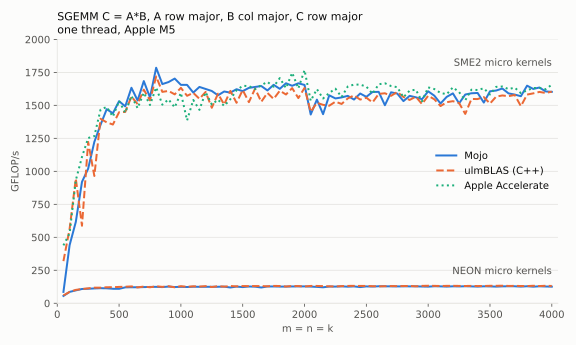
</picture>

<details>
<summary>Mojo: time and GFLOP/s</summary>

| m = n = k | NEON: time (s) | NEON: GFLOP/s | SME2: time (s) | SME2: GFLOP/s |
|---:|---:|---:|---:|---:|
| 50 | 4.494e-06 | 55.6 | 2.900e-06 | 86.2 |
| 100 | 2.320e-05 | 86.2 | 4.536e-06 | 440.9 |
| 150 | 6.912e-05 | 97.7 | 1.095e-05 | 616.4 |
| 200 | 1.478e-04 | 108.3 | 1.739e-05 | 920.1 |
| 250 | 2.840e-04 | 110.1 | 3.063e-05 | 1020.1 |
| 300 | 4.801e-04 | 112.5 | 4.415e-05 | 1223.0 |
| 350 | 7.505e-04 | 114.3 | 6.341e-05 | 1352.3 |
| 400 | 1.128e-03 | 113.4 | 8.702e-05 | 1470.9 |
| 450 | 1.657e-03 | 110.0 | 1.266e-04 | 1439.8 |
| 500 | 2.285e-03 | 109.4 | 1.632e-04 | 1531.7 |
| 550 | 2.758e-03 | 120.6 | 2.229e-04 | 1492.5 |
| 600 | 3.558e-03 | 121.4 | 2.645e-04 | 1633.3 |
| 650 | 4.538e-03 | 121.0 | 3.574e-04 | 1536.7 |
| 700 | 5.590e-03 | 122.7 | 4.074e-04 | 1683.8 |
| 750 | 6.818e-03 | 123.7 | 5.409e-04 | 1559.9 |
| 800 | 8.228e-03 | 124.4 | 5.737e-04 | 1785.0 |
| 850 | 1.002e-02 | 122.6 | 7.394e-04 | 1661.3 |
| 900 | 1.153e-02 | 126.5 | 8.696e-04 | 1676.6 |
| 950 | 1.393e-02 | 123.1 | 1.007e-03 | 1703.0 |
| 1000 | 1.606e-02 | 124.5 | 1.208e-03 | 1655.5 |
| 1050 | 1.880e-02 | 123.2 | 1.399e-03 | 1655.1 |
| 1100 | 2.125e-02 | 125.3 | 1.667e-03 | 1597.1 |
| 1150 | 2.435e-02 | 124.9 | 1.855e-03 | 1639.7 |
| 1200 | 2.766e-02 | 124.9 | 2.128e-03 | 1624.3 |
| 1250 | 3.134e-02 | 124.6 | 2.428e-03 | 1608.9 |
| 1300 | 3.514e-02 | 125.0 | 2.788e-03 | 1576.1 |
| 1350 | 3.909e-02 | 125.9 | 3.066e-03 | 1605.1 |
| 1400 | 4.586e-02 | 119.7 | 3.437e-03 | 1596.7 |
| 1450 | 4.829e-02 | 126.3 | 3.758e-03 | 1622.5 |
| 1500 | 5.506e-02 | 122.6 | 4.198e-03 | 1607.8 |
| 1550 | 5.861e-02 | 127.1 | 4.562e-03 | 1632.4 |
| 1600 | 6.512e-02 | 125.8 | 4.997e-03 | 1639.5 |
| 1650 | 7.513e-02 | 119.6 | 5.456e-03 | 1646.6 |
| 1700 | 7.713e-02 | 127.4 | 6.091e-03 | 1613.2 |
| 1750 | 8.412e-02 | 127.4 | 6.474e-03 | 1655.7 |
| 1800 | 9.225e-02 | 126.4 | 7.177e-03 | 1625.3 |
| 1850 | 1.002e-01 | 126.4 | 7.594e-03 | 1667.5 |
| 1900 | 1.076e-01 | 127.4 | 8.322e-03 | 1648.4 |
| 1950 | 1.161e-01 | 127.7 | 8.895e-03 | 1667.2 |
| 2000 | 1.253e-01 | 127.7 | 9.668e-03 | 1654.9 |
| 2050 | 1.364e-01 | 126.4 | 1.204e-02 | 1430.9 |
| 2100 | 1.493e-01 | 124.1 | 1.200e-02 | 1543.3 |
| 2150 | 1.641e-01 | 121.1 | 1.387e-02 | 1433.4 |
| 2200 | 1.679e-01 | 126.8 | 1.351e-02 | 1576.1 |
| 2250 | 1.803e-01 | 126.4 | 1.467e-02 | 1552.5 |
| 2300 | 1.900e-01 | 128.1 | 1.560e-02 | 1560.2 |
| 2350 | 2.064e-01 | 125.7 | 1.651e-02 | 1572.0 |
| 2400 | 2.164e-01 | 127.8 | 1.791e-02 | 1544.0 |
| 2450 | 2.397e-01 | 122.7 | 1.850e-02 | 1589.8 |
| 2500 | 2.446e-01 | 127.7 | 1.997e-02 | 1564.7 |
| 2550 | 2.620e-01 | 126.6 | 2.071e-02 | 1601.5 |
| 2600 | 2.726e-01 | 129.0 | 2.194e-02 | 1602.2 |
| 2650 | 2.891e-01 | 128.7 | 2.479e-02 | 1501.2 |
| 2700 | 3.071e-01 | 128.2 | 2.462e-02 | 1599.0 |
| 2750 | 3.257e-01 | 127.7 | 2.617e-02 | 1589.3 |
| 2800 | 3.417e-01 | 128.5 | 2.865e-02 | 1532.3 |
| 2850 | 3.616e-01 | 128.1 | 2.945e-02 | 1572.0 |
| 2900 | 3.799e-01 | 128.4 | 3.125e-02 | 1561.1 |
| 2950 | 4.046e-01 | 126.9 | 3.320e-02 | 1546.7 |
| 3000 | 4.288e-01 | 125.9 | 3.361e-02 | 1606.6 |
| 3050 | 4.399e-01 | 129.0 | 3.607e-02 | 1573.2 |
| 3100 | 4.652e-01 | 128.1 | 3.935e-02 | 1514.2 |
| 3150 | 4.947e-01 | 126.4 | 3.996e-02 | 1564.4 |
| 3200 | 5.097e-01 | 128.6 | 4.120e-02 | 1590.8 |
| 3250 | 5.382e-01 | 127.6 | 4.531e-02 | 1515.2 |
| 3300 | 5.574e-01 | 128.9 | 4.543e-02 | 1582.1 |
| 3350 | 5.881e-01 | 127.9 | 4.724e-02 | 1591.6 |
| 3400 | 6.225e-01 | 126.3 | 4.931e-02 | 1594.0 |
| 3450 | 6.390e-01 | 128.5 | 5.399e-02 | 1521.1 |
| 3500 | 6.706e-01 | 127.9 | 5.338e-02 | 1606.5 |
| 3550 | 7.091e-01 | 126.2 | 5.549e-02 | 1612.4 |
| 3600 | 7.284e-01 | 128.1 | 5.733e-02 | 1627.6 |
| 3650 | 7.539e-01 | 129.0 | 6.114e-02 | 1590.7 |
| 3700 | 7.872e-01 | 128.7 | 6.405e-02 | 1581.7 |
| 3750 | 8.356e-01 | 126.2 | 6.720e-02 | 1569.4 |
| 3800 | 8.509e-01 | 129.0 | 6.654e-02 | 1649.2 |
| 3850 | 9.078e-01 | 125.7 | 7.026e-02 | 1624.4 |
| 3900 | 9.220e-01 | 128.7 | 7.255e-02 | 1635.3 |
| 3950 | 9.702e-01 | 127.0 | 7.677e-02 | 1605.6 |
| 4000 | 1.017e+00 | 125.9 | 7.988e-02 | 1602.5 |

</details>

#### A column major, B row major

<picture>
  <source media="(prefers-color-scheme: dark)" srcset="results-float/A-col_B-row/gflops-dark.svg">
  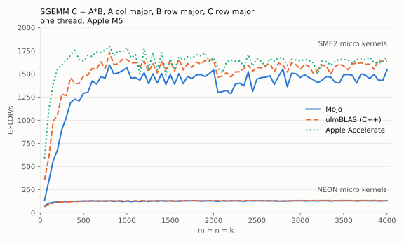
</picture>

<details>
<summary>Mojo: time and GFLOP/s</summary>

| m = n = k | NEON: time (s) | NEON: GFLOP/s | SME2: time (s) | SME2: GFLOP/s |
|---:|---:|---:|---:|---:|
| 50 | 3.417e-06 | 73.2 | 1.885e-06 | 132.6 |
| 100 | 1.966e-05 | 101.7 | 5.839e-06 | 342.5 |
| 150 | 6.020e-05 | 112.1 | 1.199e-05 | 562.9 |
| 200 | 1.383e-04 | 115.7 | 2.357e-05 | 678.7 |
| 250 | 2.584e-04 | 120.9 | 3.472e-05 | 900.1 |
| 300 | 4.523e-04 | 119.4 | 5.264e-05 | 1025.9 |
| 350 | 7.029e-04 | 122.0 | 7.204e-05 | 1190.4 |
| 400 | 1.037e-03 | 123.4 | 1.043e-04 | 1227.3 |
| 450 | 1.458e-03 | 125.0 | 1.508e-04 | 1208.2 |
| 500 | 1.970e-03 | 126.9 | 1.937e-04 | 1290.7 |
| 550 | 2.639e-03 | 126.1 | 2.559e-04 | 1300.5 |
| 600 | 3.351e-03 | 128.9 | 3.033e-04 | 1424.3 |
| 650 | 4.388e-03 | 125.2 | 3.953e-04 | 1389.5 |
| 700 | 5.382e-03 | 127.5 | 4.669e-04 | 1469.2 |
| 750 | 6.778e-03 | 124.5 | 5.802e-04 | 1454.4 |
| 800 | 7.941e-03 | 129.0 | 6.415e-04 | 1596.3 |
| 850 | 1.008e-02 | 121.9 | 8.193e-04 | 1499.2 |
| 900 | 1.139e-02 | 128.0 | 9.645e-04 | 1511.7 |
| 950 | 1.430e-02 | 119.9 | 1.117e-03 | 1535.6 |
| 1000 | 1.570e-02 | 127.4 | 1.277e-03 | 1566.0 |
| 1050 | 1.928e-02 | 120.1 | 1.592e-03 | 1454.2 |
| 1100 | 2.100e-02 | 126.8 | 1.823e-03 | 1460.4 |
| 1150 | 2.505e-02 | 121.4 | 2.124e-03 | 1432.1 |
| 1200 | 2.708e-02 | 127.6 | 2.285e-03 | 1512.5 |
| 1250 | 3.197e-02 | 122.2 | 2.802e-03 | 1394.0 |
| 1300 | 3.417e-02 | 128.6 | 2.928e-03 | 1500.9 |
| 1350 | 3.968e-02 | 124.0 | 3.511e-03 | 1401.4 |
| 1400 | 4.255e-02 | 129.0 | 3.649e-03 | 1503.9 |
| 1450 | 4.812e-02 | 126.7 | 4.403e-03 | 1385.0 |
| 1500 | 5.266e-02 | 128.2 | 4.524e-03 | 1492.2 |
| 1550 | 5.863e-02 | 127.0 | 5.364e-03 | 1388.5 |
| 1600 | 6.605e-02 | 124.0 | 5.450e-03 | 1503.2 |
| 1650 | 7.009e-02 | 128.2 | 6.443e-03 | 1394.5 |
| 1700 | 7.650e-02 | 128.4 | 6.676e-03 | 1471.8 |
| 1750 | 8.329e-02 | 128.7 | 7.396e-03 | 1449.3 |
| 1800 | 8.987e-02 | 129.8 | 7.839e-03 | 1487.9 |
| 1850 | 1.000e-01 | 126.6 | 8.479e-03 | 1493.4 |
| 1900 | 1.073e-01 | 127.8 | 9.319e-03 | 1472.1 |
| 1950 | 1.152e-01 | 128.7 | 9.862e-03 | 1503.7 |
| 2000 | 1.255e-01 | 127.5 | 1.037e-02 | 1543.1 |
| 2050 | 1.408e-01 | 122.4 | 1.327e-02 | 1298.7 |
| 2100 | 1.441e-01 | 128.5 | 1.415e-02 | 1308.6 |
| 2150 | 1.565e-01 | 127.0 | 1.505e-02 | 1320.8 |
| 2200 | 1.661e-01 | 128.2 | 1.657e-02 | 1285.4 |
| 2250 | 1.779e-01 | 128.0 | 1.641e-02 | 1388.3 |
| 2300 | 1.908e-01 | 127.5 | 1.737e-02 | 1401.3 |
| 2350 | 2.082e-01 | 124.7 | 1.894e-02 | 1370.3 |
| 2400 | 2.138e-01 | 129.3 | 1.814e-02 | 1524.3 |
| 2450 | 2.312e-01 | 127.2 | 2.245e-02 | 1310.2 |
| 2500 | 2.414e-01 | 129.5 | 2.164e-02 | 1444.0 |
| 2550 | 2.567e-01 | 129.2 | 2.272e-02 | 1459.7 |
| 2600 | 2.744e-01 | 128.1 | 2.399e-02 | 1465.2 |
| 2650 | 2.897e-01 | 128.5 | 2.515e-02 | 1480.1 |
| 2700 | 3.091e-01 | 127.4 | 2.839e-02 | 1386.4 |
| 2750 | 3.331e-01 | 124.9 | 2.820e-02 | 1475.2 |
| 2800 | 3.494e-01 | 125.6 | 2.830e-02 | 1551.6 |
| 2850 | 3.648e-01 | 126.9 | 3.401e-02 | 1361.5 |
| 2900 | 3.786e-01 | 128.8 | 3.235e-02 | 1507.7 |
| 2950 | 3.985e-01 | 128.8 | 3.417e-02 | 1502.4 |
| 3000 | 4.151e-01 | 130.1 | 3.696e-02 | 1461.0 |
| 3050 | 4.475e-01 | 126.8 | 3.806e-02 | 1490.8 |
| 3100 | 4.666e-01 | 127.7 | 4.079e-02 | 1460.6 |
| 3150 | 4.838e-01 | 129.2 | 4.353e-02 | 1436.0 |
| 3200 | 5.172e-01 | 126.7 | 4.668e-02 | 1404.0 |
| 3250 | 5.293e-01 | 129.7 | 4.799e-02 | 1430.6 |
| 3300 | 5.552e-01 | 129.5 | 4.889e-02 | 1470.1 |
| 3350 | 5.963e-01 | 126.1 | 5.129e-02 | 1466.1 |
| 3400 | 6.056e-01 | 129.8 | 5.578e-02 | 1409.3 |
| 3450 | 6.373e-01 | 128.9 | 5.865e-02 | 1400.4 |
| 3500 | 6.633e-01 | 129.3 | 5.757e-02 | 1489.5 |
| 3550 | 6.912e-01 | 129.4 | 5.991e-02 | 1493.6 |
| 3600 | 7.168e-01 | 130.2 | 6.288e-02 | 1484.0 |
| 3650 | 7.702e-01 | 126.3 | 6.941e-02 | 1401.3 |
| 3700 | 7.854e-01 | 129.0 | 6.754e-02 | 1499.8 |
| 3750 | 8.110e-01 | 130.1 | 7.095e-02 | 1486.5 |
| 3800 | 8.599e-01 | 127.6 | 7.580e-02 | 1447.7 |
| 3850 | 8.823e-01 | 129.4 | 7.633e-02 | 1495.3 |
| 3900 | 9.346e-01 | 126.9 | 8.270e-02 | 1434.6 |
| 3950 | 9.588e-01 | 128.6 | 8.633e-02 | 1427.8 |
| 4000 | 9.914e-01 | 129.1 | 8.296e-02 | 1542.9 |

</details>

#### A column major, B column major

<picture>
  <source media="(prefers-color-scheme: dark)" srcset="results-float/A-col_B-col/gflops-dark.svg">
  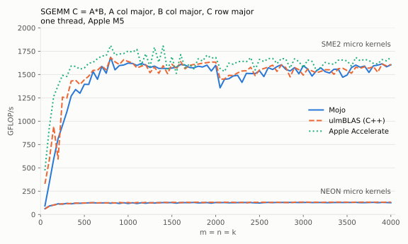
</picture>

<details>
<summary>Mojo: time and GFLOP/s</summary>

| m = n = k | NEON: time (s) | NEON: GFLOP/s | SME2: time (s) | SME2: GFLOP/s |
|---:|---:|---:|---:|---:|
| 50 | 4.038e-06 | 61.9 | 2.730e-06 | 91.6 |
| 100 | 2.195e-05 | 91.1 | 5.889e-06 | 339.6 |
| 150 | 6.673e-05 | 101.2 | 1.136e-05 | 594.1 |
| 200 | 1.397e-04 | 114.5 | 1.969e-05 | 812.7 |
| 250 | 2.818e-04 | 110.9 | 3.274e-05 | 954.6 |
| 300 | 4.524e-04 | 119.4 | 4.916e-05 | 1098.5 |
| 350 | 7.516e-04 | 114.1 | 6.753e-05 | 1269.8 |
| 400 | 1.054e-03 | 121.4 | 9.557e-05 | 1339.3 |
| 450 | 1.515e-03 | 120.3 | 1.403e-04 | 1299.3 |
| 500 | 2.045e-03 | 122.2 | 1.792e-04 | 1395.0 |
| 550 | 2.669e-03 | 124.7 | 2.388e-04 | 1393.6 |
| 600 | 3.443e-03 | 125.5 | 2.821e-04 | 1531.5 |
| 650 | 4.458e-03 | 123.2 | 3.790e-04 | 1449.1 |
| 700 | 5.551e-03 | 123.6 | 4.324e-04 | 1586.5 |
| 750 | 6.712e-03 | 125.7 | 5.573e-04 | 1513.9 |
| 800 | 8.470e-03 | 120.9 | 6.079e-04 | 1684.6 |
| 850 | 9.843e-03 | 124.8 | 7.923e-04 | 1550.2 |
| 900 | 1.231e-02 | 118.4 | 9.135e-04 | 1596.0 |
| 950 | 1.359e-02 | 126.1 | 1.070e-03 | 1602.1 |
| 1000 | 1.696e-02 | 117.9 | 1.233e-03 | 1622.3 |
| 1050 | 1.841e-02 | 125.7 | 1.431e-03 | 1618.4 |
| 1100 | 2.262e-02 | 117.7 | 1.667e-03 | 1597.0 |
| 1150 | 2.419e-02 | 125.7 | 1.879e-03 | 1618.5 |
| 1200 | 2.868e-02 | 120.5 | 2.159e-03 | 1600.9 |
| 1250 | 3.091e-02 | 126.4 | 2.479e-03 | 1575.5 |
| 1300 | 3.590e-02 | 122.4 | 2.763e-03 | 1590.2 |
| 1350 | 3.878e-02 | 126.9 | 3.144e-03 | 1565.3 |
| 1400 | 4.317e-02 | 127.1 | 3.505e-03 | 1565.9 |
| 1450 | 4.784e-02 | 127.5 | 3.898e-03 | 1564.3 |
| 1500 | 5.311e-02 | 127.1 | 4.302e-03 | 1569.0 |
| 1550 | 6.123e-02 | 121.6 | 4.719e-03 | 1578.3 |
| 1600 | 6.417e-02 | 127.7 | 5.096e-03 | 1607.6 |
| 1650 | 7.077e-02 | 127.0 | 5.612e-03 | 1600.9 |
| 1700 | 7.753e-02 | 126.7 | 6.237e-03 | 1575.3 |
| 1750 | 8.321e-02 | 128.8 | 6.821e-03 | 1571.3 |
| 1800 | 9.410e-02 | 124.0 | 7.340e-03 | 1589.0 |
| 1850 | 1.003e-01 | 126.2 | 8.012e-03 | 1580.5 |
| 1900 | 1.075e-01 | 127.6 | 8.570e-03 | 1600.7 |
| 1950 | 1.220e-01 | 121.6 | 9.644e-03 | 1537.8 |
| 2000 | 1.244e-01 | 128.6 | 1.001e-02 | 1598.7 |
| 2050 | 1.353e-01 | 127.3 | 1.269e-02 | 1357.4 |
| 2100 | 1.450e-01 | 127.7 | 1.279e-02 | 1448.0 |
| 2150 | 1.584e-01 | 125.5 | 1.366e-02 | 1454.8 |
| 2200 | 1.689e-01 | 126.1 | 1.435e-02 | 1484.1 |
| 2250 | 1.787e-01 | 127.5 | 1.527e-02 | 1491.6 |
| 2300 | 1.902e-01 | 127.9 | 1.719e-02 | 1415.5 |
| 2350 | 2.024e-01 | 128.2 | 1.716e-02 | 1512.7 |
| 2400 | 2.167e-01 | 127.6 | 1.830e-02 | 1510.7 |
| 2450 | 2.363e-01 | 124.4 | 1.948e-02 | 1509.6 |
| 2500 | 2.538e-01 | 123.1 | 2.030e-02 | 1539.7 |
| 2550 | 2.608e-01 | 127.2 | 2.244e-02 | 1478.1 |
| 2600 | 2.718e-01 | 129.3 | 2.234e-02 | 1573.6 |
| 2650 | 2.924e-01 | 127.3 | 2.396e-02 | 1553.7 |
| 2700 | 3.052e-01 | 129.0 | 2.484e-02 | 1585.0 |
| 2750 | 3.229e-01 | 128.8 | 2.592e-02 | 1604.8 |
| 2800 | 3.409e-01 | 128.8 | 2.823e-02 | 1555.4 |
| 2850 | 3.583e-01 | 129.2 | 3.010e-02 | 1538.2 |
| 2900 | 3.783e-01 | 128.9 | 3.099e-02 | 1573.8 |
| 2950 | 4.013e-01 | 127.9 | 3.406e-02 | 1507.7 |
| 3000 | 4.198e-01 | 128.6 | 3.388e-02 | 1594.0 |
| 3050 | 4.385e-01 | 129.4 | 3.639e-02 | 1559.2 |
| 3100 | 4.662e-01 | 127.8 | 4.017e-02 | 1483.3 |
| 3150 | 4.893e-01 | 127.8 | 4.060e-02 | 1539.6 |
| 3200 | 5.087e-01 | 128.8 | 4.171e-02 | 1571.4 |
| 3250 | 5.397e-01 | 127.2 | 4.485e-02 | 1531.0 |
| 3300 | 5.673e-01 | 126.7 | 4.742e-02 | 1515.7 |
| 3350 | 5.856e-01 | 128.4 | 4.831e-02 | 1556.4 |
| 3400 | 6.122e-01 | 128.4 | 5.051e-02 | 1556.2 |
| 3450 | 6.397e-01 | 128.4 | 5.584e-02 | 1470.6 |
| 3500 | 6.666e-01 | 128.6 | 5.739e-02 | 1494.2 |
| 3550 | 6.949e-01 | 128.8 | 5.685e-02 | 1574.0 |
| 3600 | 7.190e-01 | 129.8 | 5.827e-02 | 1601.4 |
| 3650 | 7.665e-01 | 126.9 | 6.163e-02 | 1578.1 |
| 3700 | 7.971e-01 | 127.1 | 6.369e-02 | 1590.6 |
| 3750 | 8.229e-01 | 128.2 | 6.928e-02 | 1522.4 |
| 3800 | 8.448e-01 | 129.9 | 6.890e-02 | 1592.7 |
| 3850 | 9.049e-01 | 126.1 | 7.131e-02 | 1600.6 |
| 3900 | 9.151e-01 | 129.6 | 7.347e-02 | 1614.8 |
| 3950 | 9.627e-01 | 128.0 | 7.788e-02 | 1582.7 |
| 4000 | 1.013e+00 | 126.3 | 7.982e-02 | 1603.6 |

</details>

## 2. If we had a competitive BLAS, could we provide a competitive LAPACK?

Short answer: yes.  [`potrf.mojo`](potrf.mojo) started as a simplified port
of ulmBLAS's task-parallel potrf.  DPOTRF (double precision positive
definite triangular factorization) computes A = L L^T or A = U^T U, in
place.  SPOTRF (single precision positive definite triangular
factorization) does the same for float, with the same code.  As everything here it works with `incRow` and `incCol`: column
major, row major and general strides, lower and upper.

> **Edit (2026-11-14):** In the meantime I ported more of the experimental
> stuff from ulmBLAS: an unrolled kernel for the diagonal blocks, and a
> worker thread that also does the copies.  Why the focus on multithreading
> the LAPACK layer? At Ulm University I am preparing the HPC course, which
> starts in about five weeks.  The students do exercises on multithreading,
> and it is a tradition that I show them something beyond: how things are
> done in a PLASMA (Parallel Linear Algebra Software for Multicore
> Architectures) style, except for copying matrices.  ulmBLAS never copied
> matrices, only blocks of fixed size, which could be allocated at
> initialization time.  I believe in rule 3 of the [Power of
> Ten](https://en.wikipedia.org/wiki/The_Power_of_10:_Rules_for_Developing_Safety-Critical_Code)
> from NASA: no dynamic memory allocation after initialization (as a student
> at [USC](https://www.usc.edu) I did my master's thesis in a
> [JPL](https://www.jpl.nasa.gov) project).  Multithreading the LAPACK layer
> is what I am currently working on in ulmBLAS, and that is what I port
> here.  If the rule were one thread, I would have spent the time on a
> different kernel.  The SME2 micro kernel was a hobby, I recently got a
> MacBook Air with an M5.

Two BLAS backends, chosen at compile time:

- the Mojo BLAS of this repository: GEMM with the SME2 micro kernel, TRSM
  and SYRK (symmetric rank-k update) on top of it, level 1 and 2 in
  [`level12.mojo`](level12.mojo);
- Apple Accelerate, but only its BLAS (`dgemm`, `dtrsm`, `dsyrk`, `ddot`,
  `dgemv`, `dscal`, and the `s` versions for float).  Everything above BLAS
  is Mojo.

Three algorithms:

- Tiles and tasks, as in PLASMA (Parallel Linear Algebra Software for
  Multicore Architectures).  POTRF (Cholesky factorization of a diagonal
  tile), TRSM, SYRK and GEMM on nb x nb tiles, a task runs as soon as its
  tiles are final.  The diagonal tiles are factored recursively like LAPACK's
  `dpotrf2`, with `dpotf2` on BLAS level 1 and 2 at the leaves.

  Unlike PLASMA, the matrix is not copied into a tile layout.  The tiles
  are blocks of the matrix in its own storage, with its own strides, and
  potrf works in place like LAPACK.  The complete copy is the only thing I
  never liked about PLASMA.  I re-implemented large parts of LAPACK, and
  for me it just felt wrong.  And it did not pay off anyway.  In
  experiments with ulmBLAS I copied the matrix into tile format, also with
  the macro kernels called directly on the tiles, so that GEMM needs no
  extra packing.  It was slower.  A copy is an optimization, not a
  simplification: where it pays off, as in the two variants below, it is
  done inside the algorithm.
- Pack once (Mojo BLAS).  The lower triangle is copied once into panels of
  32 rows.  Left-looking.  The SME2 kernels read the panels directly, no
  packing for each call.  The 32 x 32 diagonal blocks are factored on the
  core by a fully unrolled kernel: Gaussian elimination without pivoting on
  a copy on the stack, which also gives the inverse of the block in the same
  pass (the solves with the block are multiplications with the inverse).
  The square roots come only at the end, not in the dependency chain.  This
  halved the time for a diagonal block compared with potf2 and a separate
  inverse.
- Pack once with lookahead.  The same, but a second thread works on another
  core while the SME unit updates the rest: it
  factors the next diagonal block, copies the next block column of A into
  the panels and copies finished block columns back.  So the copies, which
  do not get faster on one core, are hidden behind the SME work.  Lock-free,
  with a persistent worker thread.

  For large n the packed lower triangle (n^2/2 elements) no longer fits
  into the 16 MB (megabyte) L2 (level 2) cache shared by the performance cores: for double from
  about n = 2000 on, for float from about n = 2800.  Left-looking, every
  step of 32 columns then reads all of L from DRAM (dynamic random-access
  memory), and the performance dropped by about 20% (double) and 30%
  (float) above n = 2500.  Two changes fixed this.  The update kernel
  prefetches the panel it reads next into L2.  And with a parameter w the
  update is done for w block columns in one pass, so L is read only once
  for w steps; the w - 1 block columns that become final in between are
  corrected with the few panels they still miss.  The tuning step chooses
  w = 1 almost everywhere, w = 2 for some sizes above n = 3000.

Which algorithm, how many threads and which tile size is chosen by
[`potrf_select.mojo`](potrf_select.mojo).  As in ATLAS (Automatically
Tuned Linear Algebra Software) it is generated by a tuning step on the
machine ([`tune-potrf.sh`](tune-potrf.sh)).  On the M5, for double and
float, it chooses pack once with lookahead for all n from 100 on, and pack
once for smaller n ([`tune-potrf/summary.md`](tune-potrf/summary.md)).

In a final version the select functions would be part of the package.
They are benchmarked once for every supported platform.  At run time the
implementation checks on which machine it runs and uses the matching
select function.  Tuning on the machine itself stays optional, to get the
last bit out of it.

### Benchmarks with 64 bit floats (double precision)

<picture>
  <source media="(prefers-color-scheme: dark)" srcset="results-potrf/col/gflops-dark.svg">
  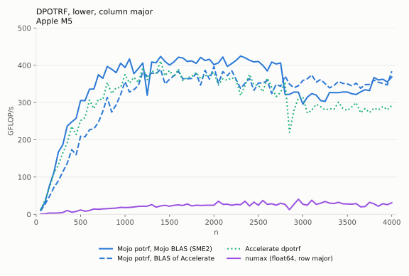
</picture>

GFLOP/s (n^3/3 operations), lower, column major:

| n | Mojo potrf, Mojo BLAS (SME2) | Mojo potrf, BLAS of Accelerate | Accelerate dpotrf | OpenBLAS dpotrf | OpenBLAS dpotrf, one thread | numax (float64, row major) |
|---:|---:|---:|---:|---:|---:|---:|
| 100 | 32 | 27 | 41 | 15 | 15 | 1 |
| 250 | 166 | 90 | 133 | 6 | 6 | 4 |
| 500 | 299 | 210 | 252 | 18 | 19 | 12 |
| 750 | 371 | 297 | 309 | 34 | 28 | 15 |
| 1000 | 386 | 362 | 361 | 52 | 62 | 18 |
| 1500 | 431 | 371 | 396 | 105 | 102 | 22 |
| 2000 | 413 | 376 | 379 | 143 | 113 | 24 |
| 3000 | 412 | 366 | 317 | 166 | 189 | 27 |
| 4000 | 397 | 359 | 294 | 195 | 213 | 31 |

<picture>
  <source media="(prefers-color-scheme: dark)" srcset="results-potrf/row/gflops-dark.svg">
  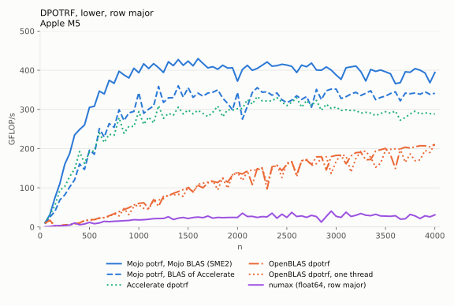
</picture>

GFLOP/s, lower, row major:

| n | Mojo potrf, Mojo BLAS (SME2) | Mojo potrf, BLAS of Accelerate | Accelerate dpotrf | OpenBLAS dpotrf | OpenBLAS dpotrf, one thread | numax (float64, row major) |
|---:|---:|---:|---:|---:|---:|---:|
| 100 | 32 | 25 | 31 | 17 | 17 | 1 |
| 250 | 160 | 82 | 104 | 6 | 6 | 4 |
| 500 | 305 | 196 | 192 | 19 | 17 | 12 |
| 750 | 367 | 254 | 234 | 34 | 34 | 15 |
| 1000 | 394 | 343 | 294 | 60 | 56 | 18 |
| 1500 | 423 | 355 | 299 | 100 | 102 | 22 |
| 2000 | 372 | 343 | 302 | 139 | 139 | 24 |
| 3000 | 388 | 352 | 306 | 183 | 168 | 27 |
| 4000 | 394 | 341 | 288 | 211 | 212 | 31 |

What this shows:

- With the Mojo BLAS the Mojo potrf is faster than Accelerate's own `dpotrf`
  from n = 150 on, for every size measured.  For n >= 250 on average by 22%
  column major and by 39% row major.
- With one thread (pack once without lookahead, numbers from the tuning
  step) the Mojo potrf is behind Accelerate up to n = 2000 and 4 to 36%
  faster for n = 2250 ... 4000.  The second thread adds no arithmetic, both
  threads share the one SME unit.  It removes waiting: diagonal blocks and
  copies run while the SME unit computes.
- With only the BLAS of Accelerate, column major, it reaches on average 95%
  of Accelerate's `dpotrf` for n = 1000 ... 2000 and is on average 14%
  faster for n > 2000.  Row major it is on average 12% faster for n >= 1000
  (faster for 58 of these 61 sizes).
- OpenBLAS's `dpotrf` reaches at most about 210 GFLOP/s, at n = 4000; for
  n <= 1000 it is below 65 GFLOP/s.  See the notes below.
- numax is 10 to 47 times slower (n >= 250).
- Small matrices (n around 100) are still open: about 79% of Accelerate
  column major, on par row major.

Notes:

- Accelerate's `dpotrf` runs on one thread.  This is not a restriction
  of the benchmark: without `VECLIB_MAXIMUM_THREADS` the results are the
  same, and the CPU time equals the wall-clock time (checked for
  n = 500 ... 4000).  Accelerate simply does not parallelize its
  `dpotrf`, although tile algorithms with task graphs are known from
  PLASMA since about 2008.  `VECLIB_MAXIMUM_THREADS=1` is only set for
  our potrf with the BLAS of Accelerate, so that its BLAS does not start
  threads inside our threads.
- Row major, Accelerate's `dpotrf` is called as column major upper on the
  same data.
- The performance cores of the M5 share one SME unit.  More threads do not
  give more GEMM throughput.  They help by overlapping, e.g. the diagonal
  blocks on the core with the updates on the SME unit.
- numax: commit f0a963f, `cholesky` with a run-time shape, float64, row
  major only (shown in both plots), measured with
  [`bench_numax_cholesky.mojo`](bench_numax_cholesky.mojo).  Its GEMM is
  `matmul` of MAX (Modular's kernel library), which for float64 uses
  MAX's own NEON kernel, not SME.
- OpenBLAS: version 0.3.34 from Homebrew, which selects its kernels for
  the M4 (`VORTEXM4`, with SME).  Measured with its default number of
  threads and with `OPENBLAS_NUM_THREADS=1`; both are about the same.  Its
  potrf is right-looking and recursive with blocks of 512 (double) or 1024
  (float) columns, parallel only fork-join inside each block column, and
  without lookahead.  Why it is so slow for small and medium n I did not
  investigate; its `dgemm` alone reaches about 250 GFLOP/s on one thread.
- Each measurement starts after a pause of 45 seconds
  (`PAUSE=45 sh run-potrf-benchmarks.sh`).  The MacBook Air has no fan,
  and back-to-back runs of several minutes lose a few percent.
- All results are checked (400 random elements of L L^T against A).

### Benchmarks with 32 bit floats (single precision)

The same for SPOTRF, with its own tuning step (`sh tune-potrf.sh --float`)
and Accelerate's `spotrf` (also on one thread), OpenBLAS's `spotrf` and
numax (float32, row major only) for comparison.  To build numax for float32 you need Apple's
Metal toolchain (`xcodebuild -downloadComponent MetalToolchain`).

<picture>
  <source media="(prefers-color-scheme: dark)" srcset="results-potrf-float/col/gflops-dark.svg">
  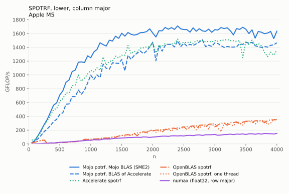
</picture>

GFLOP/s, lower, column major:

| n | Mojo potrf, Mojo BLAS (SME2) | Mojo potrf, BLAS of Accelerate | Accelerate spotrf | OpenBLAS spotrf | OpenBLAS spotrf, one thread | numax (float32, row major) |
|---:|---:|---:|---:|---:|---:|---:|
| 100 | 52 | 42 | 64 | 25 | 25 | 2 |
| 250 | 283 | 178 | 269 | 56 | 56 | 9 |
| 500 | 708 | 427 | 619 | 21 | 21 | 22 |
| 750 | 1070 | 686 | 854 | 31 | 34 | 37 |
| 1000 | 1249 | 996 | 1066 | 68 | 51 | 53 |
| 1500 | 1604 | 1224 | 1285 | 122 | 122 | 85 |
| 2000 | 1605 | 1474 | 1466 | 190 | 201 | 99 |
| 3000 | 1656 | 1465 | 1498 | 247 | 290 | 136 |
| 4000 | 1633 | 1465 | 1357 | 352 | 351 | 151 |

<picture>
  <source media="(prefers-color-scheme: dark)" srcset="results-potrf-float/row/gflops-dark.svg">
  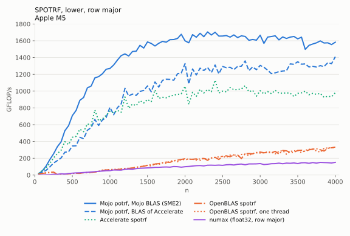
</picture>

GFLOP/s, lower, row major:

| n | Mojo potrf, Mojo BLAS (SME2) | Mojo potrf, BLAS of Accelerate | Accelerate spotrf | OpenBLAS spotrf | OpenBLAS spotrf, one thread | numax (float32, row major) |
|---:|---:|---:|---:|---:|---:|---:|
| 100 | 50 | 35 | 53 | 19 | 19 | 2 |
| 250 | 253 | 143 | 205 | 36 | 36 | 9 |
| 500 | 708 | 346 | 450 | 19 | 20 | 22 |
| 750 | 1060 | 566 | 594 | 32 | 31 | 37 |
| 1000 | 1270 | 807 | 760 | 62 | 64 | 53 |
| 1500 | 1586 | 1062 | 900 | 115 | 117 | 85 |
| 2000 | 1599 | 1327 | 1058 | 194 | 182 | 99 |
| 3000 | 1666 | 1306 | 1005 | 274 | 262 | 136 |
| 4000 | 1583 | 1409 | 980 | 333 | 329 | 151 |

What this shows:

- With the Mojo BLAS the Mojo potrf is faster than Accelerate's `spotrf`
  from n = 150 on, for every size measured.  For n >= 250 on average by 17%
  column major and by 66% row major.  Row major, Accelerate's `spotrf` is
  much slower than column major; ours is the same for both orders, because
  the panels are copied with 4 x 4 transposes.
- Here the second thread is essential.  With one thread (pack once without
  lookahead) the Mojo potrf reaches only 78 to 94% of Accelerate.  For float
  the SME unit computes twice as fast, so everything around it (diagonal
  blocks, copies) counts twice as much.
- With only the BLAS of Accelerate it reaches on average 97% of `spotrf`
  for n >= 1000 column major, and is on average 25% faster row major.
- OpenBLAS's `spotrf` reaches at most about 350 GFLOP/s, 4 to 60 times
  slower than ours.
- numax is 10 to 46 times slower (n >= 250), about the same as for double.
- Small matrices are open here too: at n = 100, 80% of Accelerate column
  major, 95% row major.

## 3. The real thing to solve: linear algebra mapping

The example from the beginning in the form I use in my lectures:

```
P, L, U <- lu(A)        // P A = L U
for l = 0, 1, ...
    b <- get_sensor_data()
    b <- P b            // swap (in place)
    b <- inv(L) b       // forward substitution (in place)
    b <- inv(U) b       // backward substitution (in place)
    react(b)
```

It teaches how to map an algorithm onto BLAS and LAPACK.  Real problems
are bigger.  Look at almost any algorithm in an AI (artificial
intelligence) model.  And this mapping can be done by a compiler.  That
is great: experts in AI can focus on the algorithms, and people
specialized in HPC can put their knowledge
into how the IR (intermediate representation) is lowered.  Writing the
algorithm and mapping it are orthogonal, and so are the things the
mapping has to decide:

- which factorization and which kernels (Cholesky instead of an inverse,
  the order of a matrix chain, one triangle of a symmetric matrix);
- on what hardware each operation runs, depending on the problem size:
  CPU, GPU (graphics processing unit), whatever-PU (processing unit);
- the parallelization.  b is in general not a vector but a matrix with K
  columns.  The compiler can generate code that computes the columns in
  parallel, on shared or distributed memory, with load balancing;
- where the data lives.  Matrices and vectors can live on different
  devices: b on the CPU, the factorization on a GPU.  Then b is streamed
  to the solver on the GPU (or whatever accelerator is used) as it comes,
  and back.  That is one possible path.  The compiler generates code so
  that, depending on the problem and its size, the best path is used.

The last point is what `potrf_select` does in section 2 on a small
scale: the algorithm, the number of threads and the tile size depend on
n and the machine.

### ulm.lam

[ulm.lam](https://github.com/michael-lehn/ulm-lam) (Ulm Linear Algebra
Mapping) is my compiler for this, built on MLIR.  You write linear algebra
in Python or Julia the way it is written in a paper and declare what you
know about the matrices (SPD (symmetric positive definite), full rank,
triangular, ...).  ulm.lam derives the BLAS and LAPACK calls an expert
would write: factorizations instead of inverses, each computed once,
symmetry exploited, the order of products chosen at run time when it
depends on sizes known only then, temporaries in one workspace, no
allocations in loops.  Some results from its README (Apple M5):

- GLS (generalized least squares), n = 2000, m = 50: 8.1 times faster
  than the formula as written in Julia, as fast as written by an expert,
  3.4 KiB instead of 34 to 64 MiB of memory.
- The K-FAC (Kronecker-factored approximate curvature) optimizer: four
  functions of two or three lines each, 1.7 times faster than
  kfac-pytorch for its part of a training step, with the same iterates
  (to 1e-14) as its method reproduced in float64.
- The Laplace approximation of a last layer: one formula, two algorithms
  (a direct Cholesky or the Woodbury identity), chosen at run time.  As
  fast as the better of the two written by hand; the wrong choice by
  hand is up to 538 times slower.

Today ulm.lam emits C++ (and Julia) that calls ulmBLAS or any BLAS and
LAPACK.  Emitting Mojo is the natural next step, calling Mojo kernels like
the GEMM and the POTRF above.

**And that was actually the reason why I looked into Mojo in the first
place :D**

Then the example from the beginning runs end to end in Mojo: a formula
in, BLAS and LAPACK calls out, on whatever hardware fits.

## 4. Thoughts: what Mojo would need to enter the HPC game

From my experience all this only works with an infrastructure like
[BLIS](https://github.com/flame/blis).  In BLIS a new platform needs micro
kernels and a few block sizes.  Everything else comes on top: packing,
macro kernels, all of level 3, LAPACK.  AI assistance can help a lot in
developing such an infrastructure.  But it still needs experts:

- Experts that provide micro kernels for new platforms.  They do not have
  to be written by hand.  At the
  [FAMLIES (Framework for Advanced (Multi)Linear Infrastructure in
  Engineering and Science) 2026 retreat](https://www.cs.utexas.edu/~flame/FAMLIES/Retreat2026/program-at-a-glance.html)
  Stepan Nassyr presented [ukrgen](https://github.com/linedot/ukrgen),
  the state of the art for this.  It derives micro kernels from the
  operations a matrix ISA (instruction set architecture) offers, such as
  the outer products of SME, generates the candidates and measures them.
  He also points out the large per-call cost of such kernels.  That is
  exactly what limits the small sizes in section 1.
- Experts from numerical linear algebra that contribute, or at least
  provide expertise.  Section 2 shows why: with the same BLAS, the
  algorithm decides (pack once, lookahead, what runs where).
- Tuning per platform: select functions benchmarked once for every
  supported platform and shipped with the package, as in section 2.
- On top, a compiler for the LAMP (section 3).  At the same retreat Paolo
  Bientinesi showed how far common languages and libraries are from
  solving it ([arXiv:1911.09421](https://arxiv.org/abs/1911.09421)).

So one has to establish a community, kind of an inner circle, and design
it so that it can benefit from the research that is going on in this
domain: new generators, new hardware, new ways of mapping.

Mojo has a lot that fits.  It is built on MLIR, and generators like the
ones above produce MLIR anyway.  Parameters make kernels configurable at
compile time.  Inline assembly works (the SME2 kernel here).  And for the
people in AI it looks like Python.

What I missed in this experiment (Mojo 1.2):

- No threads in the standard library.  potrf uses `sync_parallelize` of
  MAX, and its persistent worker thread is a pthread created through the
  FFI (foreign function interface).
- For SME: `llvm.arm_new_za` has no effect, so ZA (the matrix storage of
  SME) is switched on by hand, and SIMD code in streaming mode is compiled
  to 128-bit vectors only.
- No LAPACK-level operations in MAX.

## Files and how to run

- [`gemm.mojo`](gemm.mojo): packing, macro kernel, NEON micro kernel and
  the driver;
- [`ugemm_sme.mojo`](ugemm_sme.mojo): the SME2 micro kernel;
- [`bench.mojo`](bench.mojo): the benchmark;
- [`test.mojo`](test.mojo): tests for column major, row major and general
  strides;
- [`run-benchmarks.sh`](run-benchmarks.sh): all benchmarks above,
  [`plot.py`](plot.py): the plots and tables, [`results/`](results) and
  [`results-float/`](results-float): the raw results.
- [`potrf.mojo`](potrf.mojo): the Cholesky factorization (tiles and
  tasks, pack once, lookahead), [`level12.mojo`](level12.mojo): BLAS level
  1 and 2;
- [`tune-potrf.sh`](tune-potrf.sh), [`gen_potrf_select.py`](gen_potrf_select.py):
  the tuning step that generates [`potrf_select.mojo`](potrf_select.mojo);
- [`bench_potrf.mojo`](bench_potrf.mojo), [`test_potrf.mojo`](test_potrf.mojo):
  benchmark and tests of potrf;
- [`run-potrf-benchmarks.sh`](run-potrf-benchmarks.sh),
  [`plot_potrf.py`](plot_potrf.py), [`results-potrf/`](results-potrf),
  [`results-potrf-float/`](results-potrf-float): the potrf benchmarks, [`bench_numax_cholesky.mojo`](bench_numax_cholesky.mojo):
  numax.

```sh
pixi run test
pixi run build
./bench sme                                    # C = A*B, all row major
./bench neon --A=col --B=col --C=col 500 1000  # column major, two sizes
./bench sme --alpha=2 --beta=1                 # C = C + 2*A*B
./bench sme --float                            # SGEMM
pixi run test-potrf
pixi run build-potrf
./bench-potrf sme --threads=auto 1000 2000     # DPOTRF, chosen by potrf_select
./bench-potrf accelerate-blas --threads=auto   # with the BLAS of Accelerate
./bench-potrf sme --float --threads=auto       # SPOTRF
sh tune-potrf.sh                               # tuning step (half an hour)
sh tune-potrf.sh --float                       # the same for float
```

`./bench PATH` measures `cblas_dgemm` of the shared library `PATH` with
the same options.
