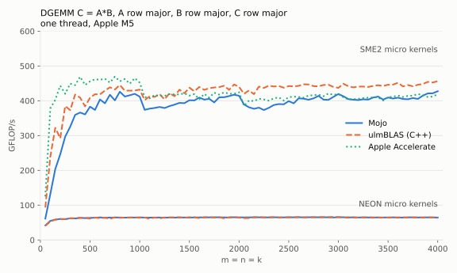
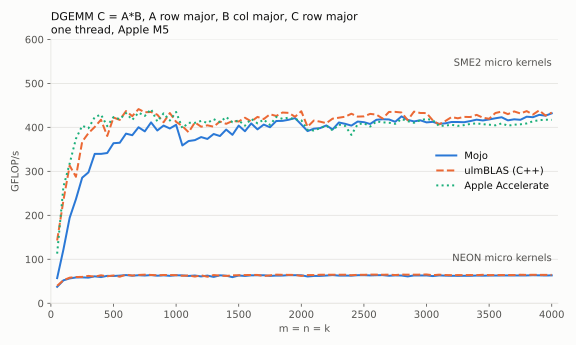
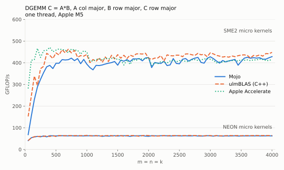
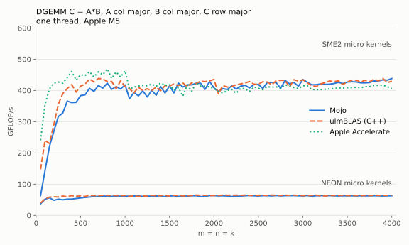

# mojo-gemm: DGEMM (double precision general matrix-matrix multiply) in Mojo

I am evaluating whether it is possible to implement a high performance
DGEMM in [Mojo](https://mojolang.org).

This is my first experiment with Mojo.  It is not a full port of the GEMM
(general matrix-matrix multiply) in ulmBLAS.  It is roughly what my
students implement in my course HPC1 (High Performance Computing 1).

The idea is simple and explained in my GEMM tutorial
[gemm-tutorial](https://github.com/michael-lehn/gemm-tutorial):

- exploit the cache hierarchy: packing of blocks of A and B, and a macro
  kernel that runs over the packed blocks;
- do the multiplication with the SIMD (single instruction, multiple data)
  features of the CPU (central processing unit): a micro kernel that keeps
  a small tile of C in registers.

The micro kernels are basically those of
[ulmBLAS](https://github.com/michael-lehn/ulmBLAS), my BLAS (Basic Linear
Algebra Subprograms) implementation in C++:
[NEON](https://github.com/michael-lehn/ulmBLAS/blob/master/ulmblas/level3/ukernel/neon/ugemm.tcc)
(an 8 x 6 tile, here written in plain Mojo SIMD code) and
[SME2 (Scalable Matrix Extension 2)](https://github.com/michael-lehn/ulmBLAS/blob/master/ulmblas/level3/ukernel/sme/ugemm.tcc)
(a 32 x 16 tile, here ported to inline assembly).

What is special: as in BLIS (BLAS-like Library Instantiation Software), the
matrices do not have to be stored column major.  Row major is fine, and so
are matrices whose rows and columns have an arbitrary (but constant) stride:
element (i, j) of A is `A[i*incRowA + j*incColA]`.  The micro kernels
write C fastest if it is column major; if C is closer to row major, the
driver computes C^T = B^T A^T instead.

Why GEMM is important:

- The performance of all BLAS level 3 functions (SYMM (symmetric
  matrix-matrix multiply), TRMM (triangular matrix-matrix multiply), TRSM
  (triangular solve with multiple right-hand sides), ...) depends on the platform specific micro kernel.
- The performance of LAPACK (Linear Algebra PACKage) depends on the
  efficiency of the BLAS.

## Benchmarks

C = A*B with m = n = k = 50, 100, ..., 4000, C row major, for the four
storage orders of A and B.  One thread on an Apple M5 (macOS 26.6),
Mojo 1.2.0.  For comparison: ulmBLAS (C++, commit
[4a0b610e](https://github.com/michael-lehn/ulmBLAS/commit/4a0b610e)) with
its NEON and SME2 micro kernels, and Apple Accelerate.  All implementations
are measured by the same program ([`bench.mojo`](bench.mojo)); every result
is checked.

For large matrices Mojo is close to ulmBLAS.  With NEON the difference is
about 2%.  With SME2 it is about 5% for n >= 500.  For small matrices the
SME2 version falls behind.  At n = 250 it reaches about 63% of ulmBLAS, at
n = 100 about half.  The SME2 unit computes so fast that everything around
the micro kernel matters.  ulmBLAS packs A and B in streaming mode.  It
handles partial tiles with predicates.  This port does neither.  Small
matrices simply need special treatment.  That is why I am currently
optimizing ulmBLAS for smaller dimensions.

### A row major, B row major

<picture>
  <source media="(prefers-color-scheme: dark)" srcset="results/A-row_B-row/gflops-dark.svg">
  
</picture>

<details>
<summary>Mojo: time and GFLOP/s (giga floating-point operations per second)</summary>

| m = n = k | NEON: time (s) | NEON: GFLOP/s | SME2: time (s) | SME2: GFLOP/s |
|---:|---:|---:|---:|---:|
| 50 | 6.286e-06 | 39.8 | 5.514e-06 | 45.3 |
| 100 | 3.883e-05 | 51.5 | 1.685e-05 | 118.7 |
| 150 | 1.182e-04 | 57.1 | 4.015e-05 | 168.1 |
| 200 | 2.718e-04 | 58.9 | 6.841e-05 | 233.9 |
| 250 | 5.241e-04 | 59.6 | 1.324e-04 | 236.1 |
| 300 | 8.795e-04 | 61.4 | 2.096e-04 | 257.7 |
| 350 | 1.406e-03 | 61.0 | 2.881e-04 | 297.6 |
| 400 | 2.039e-03 | 62.8 | 3.706e-04 | 345.3 |
| 450 | 2.903e-03 | 62.8 | 5.066e-04 | 359.7 |
| 500 | 4.284e-03 | 58.4 | 7.035e-04 | 355.4 |
| 550 | 5.235e-03 | 63.6 | 8.765e-04 | 379.6 |
| 600 | 7.047e-03 | 61.3 | 1.152e-03 | 374.9 |
| 650 | 8.661e-03 | 63.4 | 1.434e-03 | 383.1 |
| 700 | 1.135e-02 | 60.5 | 1.745e-03 | 393.0 |
| 750 | 1.310e-02 | 64.4 | 2.190e-03 | 385.3 |
| 800 | 1.633e-02 | 62.7 | 2.428e-03 | 421.8 |
| 850 | 1.923e-02 | 63.9 | 3.053e-03 | 402.3 |
| 900 | 2.367e-02 | 61.6 | 3.571e-03 | 408.3 |
| 950 | 2.691e-02 | 63.7 | 4.195e-03 | 408.7 |
| 1000 | 3.320e-02 | 60.2 | 5.013e-03 | 399.0 |
| 1050 | 3.741e-02 | 61.9 | 6.160e-03 | 375.8 |
| 1100 | 4.519e-02 | 58.9 | 7.193e-03 | 370.1 |
| 1150 | 4.860e-02 | 62.6 | 8.029e-03 | 378.9 |
| 1200 | 5.686e-02 | 60.8 | 8.680e-03 | 398.2 |
| 1250 | 6.121e-02 | 63.8 | 9.997e-03 | 390.7 |
| 1300 | 6.953e-02 | 63.2 | 1.103e-02 | 398.3 |
| 1350 | 7.849e-02 | 62.7 | 1.242e-02 | 396.1 |
| 1400 | 8.673e-02 | 63.3 | 1.366e-02 | 401.7 |
| 1450 | 1.006e-01 | 60.6 | 1.533e-02 | 397.7 |
| 1500 | 1.061e-01 | 63.6 | 1.664e-02 | 405.8 |
| 1550 | 1.165e-01 | 63.9 | 1.814e-02 | 410.6 |
| 1600 | 1.353e-01 | 60.6 | 1.977e-02 | 414.3 |
| 1650 | 1.440e-01 | 62.4 | 2.190e-02 | 410.3 |
| 1700 | 1.541e-01 | 63.7 | 2.411e-02 | 407.5 |
| 1750 | 1.694e-01 | 63.3 | 2.579e-02 | 415.7 |
| 1800 | 1.826e-01 | 63.9 | 2.904e-02 | 401.6 |
| 1850 | 2.112e-01 | 60.0 | 3.015e-02 | 420.0 |
| 1900 | 2.151e-01 | 63.8 | 3.504e-02 | 391.5 |
| 1950 | 2.342e-01 | 63.3 | 3.474e-02 | 426.8 |
| 2000 | 2.496e-01 | 64.1 | 3.752e-02 | 426.5 |
| 2050 | 2.719e-01 | 63.4 | 4.390e-02 | 392.5 |
| 2100 | 2.924e-01 | 63.4 | 4.585e-02 | 403.9 |
| 2150 | 3.215e-01 | 61.8 | 5.224e-02 | 380.5 |
| 2200 | 3.412e-01 | 62.4 | 5.196e-02 | 409.9 |
| 2250 | 3.596e-01 | 63.3 | 5.653e-02 | 403.0 |
| 2300 | 3.918e-01 | 62.1 | 6.472e-02 | 376.0 |
| 2350 | 4.094e-01 | 63.4 | 6.344e-02 | 409.1 |
| 2400 | 4.425e-01 | 62.5 | 6.591e-02 | 419.5 |
| 2450 | 4.670e-01 | 63.0 | 7.645e-02 | 384.7 |
| 2500 | 4.976e-01 | 62.8 | 7.514e-02 | 415.9 |
| 2550 | 5.300e-01 | 62.6 | 7.924e-02 | 418.5 |
| 2600 | 5.539e-01 | 63.5 | 8.583e-02 | 409.6 |
| 2650 | 5.908e-01 | 63.0 | 8.957e-02 | 415.5 |
| 2700 | 6.287e-01 | 62.6 | 9.336e-02 | 421.6 |
| 2750 | 6.606e-01 | 63.0 | 9.822e-02 | 423.5 |
| 2800 | 6.975e-01 | 62.9 | 1.030e-01 | 426.4 |
| 2850 | 7.379e-01 | 62.7 | 1.160e-01 | 399.2 |
| 2900 | 7.666e-01 | 63.6 | 1.150e-01 | 424.1 |
| 2950 | 8.156e-01 | 63.0 | 1.209e-01 | 424.8 |
| 3000 | 8.683e-01 | 62.2 | 1.259e-01 | 428.7 |
| 3050 | 8.991e-01 | 63.1 | 1.356e-01 | 418.6 |
| 3100 | 9.693e-01 | 61.5 | 1.488e-01 | 400.3 |
| 3150 | 9.905e-01 | 63.1 | 1.537e-01 | 406.8 |
| 3200 | 1.050e+00 | 62.4 | 1.580e-01 | 414.8 |
| 3250 | 1.102e+00 | 62.3 | 1.646e-01 | 417.1 |
| 3300 | 1.143e+00 | 62.9 | 1.718e-01 | 418.3 |
| 3350 | 1.207e+00 | 62.3 | 1.801e-01 | 417.4 |
| 3400 | 1.262e+00 | 62.3 | 1.907e-01 | 412.2 |
| 3450 | 1.328e+00 | 61.8 | 2.024e-01 | 405.7 |
| 3500 | 1.376e+00 | 62.3 | 2.022e-01 | 424.1 |
| 3550 | 1.438e+00 | 62.2 | 2.114e-01 | 423.2 |
| 3600 | 1.499e+00 | 62.3 | 2.178e-01 | 428.4 |
| 3650 | 1.549e+00 | 62.8 | 2.293e-01 | 424.2 |
| 3700 | 1.638e+00 | 61.9 | 2.384e-01 | 425.0 |
| 3750 | 1.683e+00 | 62.7 | 2.480e-01 | 425.3 |
| 3800 | 1.753e+00 | 62.6 | 2.558e-01 | 429.1 |
| 3850 | 1.826e+00 | 62.5 | 2.679e-01 | 426.1 |
| 3900 | 1.895e+00 | 62.6 | 2.783e-01 | 426.2 |
| 3950 | 1.975e+00 | 62.4 | 2.917e-01 | 422.6 |
| 4000 | 2.043e+00 | 62.7 | 2.967e-01 | 431.3 |

</details>

### A row major, B column major

<picture>
  <source media="(prefers-color-scheme: dark)" srcset="results/A-row_B-col/gflops-dark.svg">
  
</picture>

<details>
<summary>Mojo: time and GFLOP/s (giga floating-point operations per second)</summary>

| m = n = k | NEON: time (s) | NEON: GFLOP/s | SME2: time (s) | SME2: GFLOP/s |
|---:|---:|---:|---:|---:|
| 50 | 6.854e-06 | 36.5 | 5.127e-06 | 48.8 |
| 100 | 4.029e-05 | 49.6 | 1.751e-05 | 114.2 |
| 150 | 1.207e-04 | 55.9 | 3.874e-05 | 174.2 |
| 200 | 2.774e-04 | 57.7 | 7.162e-05 | 223.4 |
| 250 | 5.344e-04 | 58.5 | 1.350e-04 | 231.5 |
| 300 | 9.313e-04 | 58.0 | 2.143e-04 | 252.0 |
| 350 | 1.458e-03 | 58.8 | 2.991e-04 | 286.7 |
| 400 | 2.248e-03 | 56.9 | 3.869e-04 | 330.8 |
| 450 | 2.986e-03 | 61.0 | 5.315e-04 | 342.9 |
| 500 | 4.253e-03 | 58.8 | 7.286e-04 | 343.1 |
| 550 | 5.444e-03 | 61.1 | 9.315e-04 | 357.2 |
| 600 | 7.260e-03 | 59.5 | 1.196e-03 | 361.1 |
| 650 | 8.879e-03 | 61.9 | 1.481e-03 | 370.8 |
| 700 | 1.136e-02 | 60.4 | 1.821e-03 | 376.7 |
| 750 | 1.370e-02 | 61.6 | 2.265e-03 | 372.5 |
| 800 | 1.704e-02 | 60.1 | 2.506e-03 | 408.6 |
| 850 | 2.030e-02 | 60.5 | 3.122e-03 | 393.4 |
| 900 | 2.409e-02 | 60.5 | 3.677e-03 | 396.5 |
| 950 | 2.837e-02 | 60.4 | 4.282e-03 | 400.4 |
| 1000 | 3.346e-02 | 59.8 | 5.013e-03 | 399.0 |
| 1050 | 3.810e-02 | 60.8 | 6.386e-03 | 362.5 |
| 1100 | 4.499e-02 | 59.2 | 7.484e-03 | 355.7 |
| 1150 | 5.013e-02 | 60.7 | 8.234e-03 | 369.4 |
| 1200 | 5.799e-02 | 59.6 | 9.262e-03 | 373.1 |
| 1250 | 6.466e-02 | 60.4 | 1.034e-02 | 377.8 |
| 1300 | 7.134e-02 | 61.6 | 1.133e-02 | 387.7 |
| 1350 | 8.065e-02 | 61.0 | 1.269e-02 | 387.8 |
| 1400 | 8.953e-02 | 61.3 | 1.420e-02 | 386.4 |
| 1450 | 1.031e-01 | 59.1 | 1.555e-02 | 392.1 |
| 1500 | 1.100e-01 | 61.4 | 1.704e-02 | 396.1 |
| 1550 | 1.211e-01 | 61.5 | 1.863e-02 | 399.8 |
| 1600 | 1.354e-01 | 60.5 | 2.025e-02 | 404.6 |
| 1650 | 1.445e-01 | 62.2 | 2.219e-02 | 405.0 |
| 1700 | 1.583e-01 | 62.1 | 2.489e-02 | 394.8 |
| 1750 | 1.744e-01 | 61.5 | 2.612e-02 | 410.4 |
| 1800 | 1.891e-01 | 61.7 | 2.964e-02 | 393.5 |
| 1850 | 2.143e-01 | 59.1 | 3.057e-02 | 414.2 |
| 1900 | 2.230e-01 | 61.5 | 3.641e-02 | 376.7 |
| 1950 | 2.398e-01 | 61.8 | 3.509e-02 | 422.6 |
| 2000 | 2.597e-01 | 61.6 | 3.865e-02 | 414.0 |
| 2050 | 2.808e-01 | 61.4 | 4.571e-02 | 377.0 |
| 2100 | 3.028e-01 | 61.2 | 4.700e-02 | 394.1 |
| 2150 | 3.322e-01 | 59.8 | 5.024e-02 | 395.6 |
| 2200 | 3.456e-01 | 61.6 | 5.368e-02 | 396.7 |
| 2250 | 3.713e-01 | 61.4 | 5.645e-02 | 403.6 |
| 2300 | 3.989e-01 | 61.0 | 6.204e-02 | 392.2 |
| 2350 | 4.361e-01 | 59.5 | 6.372e-02 | 407.3 |
| 2400 | 4.544e-01 | 60.8 | 6.730e-02 | 410.8 |
| 2450 | 4.814e-01 | 61.1 | 7.406e-02 | 397.1 |
| 2500 | 5.172e-01 | 60.4 | 7.565e-02 | 413.1 |
| 2550 | 5.387e-01 | 61.6 | 8.022e-02 | 413.4 |
| 2600 | 5.704e-01 | 61.6 | 8.890e-02 | 395.4 |
| 2650 | 6.049e-01 | 61.5 | 8.896e-02 | 418.4 |
| 2700 | 6.365e-01 | 61.8 | 9.405e-02 | 418.6 |
| 2750 | 6.725e-01 | 61.8 | 9.912e-02 | 419.6 |
| 2800 | 7.187e-01 | 61.1 | 1.054e-01 | 416.6 |
| 2850 | 7.513e-01 | 61.6 | 1.145e-01 | 404.4 |
| 2900 | 7.942e-01 | 61.4 | 1.153e-01 | 422.9 |
| 2950 | 8.301e-01 | 61.9 | 1.216e-01 | 422.3 |
| 3000 | 8.713e-01 | 62.0 | 1.285e-01 | 420.4 |
| 3050 | 9.273e-01 | 61.2 | 1.367e-01 | 415.0 |
| 3100 | 9.694e-01 | 61.5 | 1.493e-01 | 399.2 |
| 3150 | 1.028e+00 | 60.8 | 1.584e-01 | 394.6 |
| 3200 | 1.082e+00 | 60.6 | 1.610e-01 | 407.0 |
| 3250 | 1.108e+00 | 62.0 | 1.659e-01 | 413.8 |
| 3300 | 1.163e+00 | 61.8 | 1.735e-01 | 414.2 |
| 3350 | 1.223e+00 | 61.5 | 1.833e-01 | 410.2 |
| 3400 | 1.285e+00 | 61.2 | 1.961e-01 | 400.8 |
| 3450 | 1.335e+00 | 61.5 | 2.050e-01 | 400.7 |
| 3500 | 1.382e+00 | 62.0 | 2.057e-01 | 416.8 |
| 3550 | 1.450e+00 | 61.7 | 2.125e-01 | 421.1 |
| 3600 | 1.501e+00 | 62.2 | 2.238e-01 | 417.0 |
| 3650 | 1.581e+00 | 61.5 | 2.315e-01 | 420.1 |
| 3700 | 1.641e+00 | 61.7 | 2.400e-01 | 422.1 |
| 3750 | 1.707e+00 | 61.8 | 2.501e-01 | 421.6 |
| 3800 | 1.776e+00 | 61.8 | 2.609e-01 | 420.7 |
| 3850 | 1.844e+00 | 61.9 | 2.700e-01 | 422.7 |
| 3900 | 1.917e+00 | 61.9 | 2.900e-01 | 409.0 |
| 3950 | 1.989e+00 | 62.0 | 3.038e-01 | 405.7 |
| 4000 | 2.071e+00 | 61.8 | 3.069e-01 | 417.0 |

</details>

### A column major, B row major

<picture>
  <source media="(prefers-color-scheme: dark)" srcset="results/A-col_B-row/gflops-dark.svg">
  
</picture>

<details>
<summary>Mojo: time and GFLOP/s (giga floating-point operations per second)</summary>

| m = n = k | NEON: time (s) | NEON: GFLOP/s | SME2: time (s) | SME2: GFLOP/s |
|---:|---:|---:|---:|---:|
| 50 | 6.348e-06 | 39.4 | 6.972e-06 | 35.9 |
| 100 | 3.884e-05 | 51.5 | 1.624e-05 | 123.2 |
| 150 | 1.247e-04 | 54.1 | 3.924e-05 | 172.0 |
| 200 | 2.784e-04 | 57.5 | 6.852e-05 | 233.5 |
| 250 | 5.317e-04 | 58.8 | 1.291e-04 | 242.0 |
| 300 | 9.077e-04 | 59.5 | 2.087e-04 | 258.8 |
| 350 | 1.409e-03 | 60.9 | 2.894e-04 | 296.3 |
| 400 | 2.149e-03 | 59.6 | 3.671e-04 | 348.7 |
| 450 | 3.049e-03 | 59.8 | 5.157e-04 | 353.4 |
| 500 | 4.229e-03 | 59.1 | 7.015e-04 | 356.4 |
| 550 | 5.452e-03 | 61.0 | 8.845e-04 | 376.2 |
| 600 | 7.347e-03 | 58.8 | 1.143e-03 | 378.0 |
| 650 | 9.068e-03 | 60.6 | 1.442e-03 | 380.8 |
| 700 | 1.178e-02 | 58.2 | 1.752e-03 | 391.5 |
| 750 | 1.374e-02 | 61.4 | 2.198e-03 | 383.9 |
| 800 | 1.769e-02 | 57.9 | 2.527e-03 | 405.3 |
| 850 | 2.037e-02 | 60.3 | 3.095e-03 | 396.8 |
| 900 | 2.460e-02 | 59.3 | 3.819e-03 | 381.7 |
| 950 | 2.833e-02 | 60.5 | 4.331e-03 | 395.9 |
| 1000 | 3.362e-02 | 59.5 | 5.087e-03 | 393.2 |
| 1050 | 3.816e-02 | 60.7 | 6.280e-03 | 368.7 |
| 1100 | 4.612e-02 | 57.7 | 7.393e-03 | 360.1 |
| 1150 | 4.957e-02 | 61.4 | 8.477e-03 | 358.8 |
| 1200 | 5.587e-02 | 61.9 | 8.838e-03 | 391.0 |
| 1250 | 6.428e-02 | 60.8 | 1.022e-02 | 382.2 |
| 1300 | 7.244e-02 | 60.7 | 1.143e-02 | 384.4 |
| 1350 | 8.180e-02 | 60.2 | 1.259e-02 | 390.8 |
| 1400 | 8.960e-02 | 61.2 | 1.402e-02 | 391.5 |
| 1450 | 1.005e-01 | 60.7 | 1.560e-02 | 391.0 |
| 1500 | 1.145e-01 | 59.0 | 1.721e-02 | 392.2 |
| 1550 | 1.222e-01 | 61.0 | 1.870e-02 | 398.4 |
| 1600 | 1.332e-01 | 61.5 | 2.047e-02 | 400.2 |
| 1650 | 1.493e-01 | 60.2 | 2.207e-02 | 407.2 |
| 1700 | 1.612e-01 | 61.0 | 2.514e-02 | 390.9 |
| 1750 | 1.734e-01 | 61.8 | 2.613e-02 | 410.3 |
| 1800 | 1.896e-01 | 61.5 | 2.846e-02 | 409.8 |
| 1850 | 2.064e-01 | 61.3 | 3.063e-02 | 413.4 |
| 1900 | 2.256e-01 | 60.8 | 3.548e-02 | 386.7 |
| 1950 | 2.457e-01 | 60.4 | 3.649e-02 | 406.4 |
| 2000 | 2.631e-01 | 60.8 | 3.825e-02 | 418.3 |
| 2050 | 2.815e-01 | 61.2 | 4.586e-02 | 375.7 |
| 2100 | 3.017e-01 | 61.4 | 4.650e-02 | 398.3 |
| 2150 | 3.231e-01 | 61.5 | 5.101e-02 | 389.6 |
| 2200 | 3.461e-01 | 61.5 | 5.505e-02 | 386.8 |
| 2250 | 3.705e-01 | 61.5 | 5.640e-02 | 403.9 |
| 2300 | 3.959e-01 | 61.5 | 6.340e-02 | 383.8 |
| 2350 | 4.233e-01 | 61.3 | 6.690e-02 | 388.0 |
| 2400 | 4.552e-01 | 60.7 | 6.569e-02 | 420.9 |
| 2450 | 4.849e-01 | 60.7 | 7.367e-02 | 399.2 |
| 2500 | 5.086e-01 | 61.4 | 8.045e-02 | 388.4 |
| 2550 | 5.366e-01 | 61.8 | 8.023e-02 | 413.4 |
| 2600 | 5.684e-01 | 61.8 | 8.453e-02 | 415.9 |
| 2650 | 6.026e-01 | 61.8 | 9.237e-02 | 403.0 |
| 2700 | 6.255e-01 | 62.9 | 9.885e-02 | 398.3 |
| 2750 | 6.766e-01 | 61.5 | 1.010e-01 | 411.7 |
| 2800 | 6.998e-01 | 62.7 | 1.048e-01 | 419.1 |
| 2850 | 7.524e-01 | 61.5 | 1.188e-01 | 389.7 |
| 2900 | 7.984e-01 | 61.1 | 1.169e-01 | 417.3 |
| 2950 | 8.322e-01 | 61.7 | 1.226e-01 | 418.9 |
| 3000 | 8.893e-01 | 60.7 | 1.287e-01 | 419.6 |
| 3050 | 9.123e-01 | 62.2 | 1.404e-01 | 404.3 |
| 3100 | 9.748e-01 | 61.1 | 1.464e-01 | 407.1 |
| 3150 | 1.015e+00 | 61.6 | 1.576e-01 | 396.7 |
| 3200 | 1.068e+00 | 61.4 | 1.618e-01 | 405.0 |
| 3250 | 1.118e+00 | 61.4 | 1.738e-01 | 395.0 |
| 3300 | 1.173e+00 | 61.3 | 1.789e-01 | 401.8 |
| 3350 | 1.229e+00 | 61.2 | 1.878e-01 | 400.4 |
| 3400 | 1.294e+00 | 60.8 | 1.939e-01 | 405.5 |
| 3450 | 1.347e+00 | 61.0 | 2.110e-01 | 389.2 |
| 3500 | 1.425e+00 | 60.2 | 2.053e-01 | 417.6 |
| 3550 | 1.462e+00 | 61.2 | 2.140e-01 | 418.1 |
| 3600 | 1.515e+00 | 61.6 | 2.197e-01 | 424.6 |
| 3650 | 1.563e+00 | 62.2 | 2.324e-01 | 418.5 |
| 3700 | 1.653e+00 | 61.3 | 2.416e-01 | 419.3 |
| 3750 | 1.723e+00 | 61.2 | 2.528e-01 | 417.3 |
| 3800 | 1.786e+00 | 61.5 | 2.647e-01 | 414.5 |
| 3850 | 1.835e+00 | 62.2 | 2.750e-01 | 415.0 |
| 3900 | 1.903e+00 | 62.3 | 2.865e-01 | 414.2 |
| 3950 | 1.996e+00 | 61.8 | 2.964e-01 | 415.9 |
| 4000 | 2.058e+00 | 62.2 | 3.004e-01 | 426.1 |

</details>

### A column major, B column major

<picture>
  <source media="(prefers-color-scheme: dark)" srcset="results/A-col_B-col/gflops-dark.svg">
  
</picture>

<details>
<summary>Mojo: time and GFLOP/s (giga floating-point operations per second)</summary>

| m = n = k | NEON: time (s) | NEON: GFLOP/s | SME2: time (s) | SME2: GFLOP/s |
|---:|---:|---:|---:|---:|
| 50 | 6.821e-06 | 36.7 | 7.001e-06 | 35.7 |
| 100 | 4.076e-05 | 49.1 | 1.871e-05 | 106.9 |
| 150 | 1.217e-04 | 55.5 | 4.445e-05 | 151.9 |
| 200 | 2.921e-04 | 54.8 | 7.147e-05 | 223.9 |
| 250 | 5.398e-04 | 57.9 | 1.353e-04 | 230.9 |
| 300 | 9.548e-04 | 56.6 | 2.024e-04 | 266.8 |
| 350 | 1.434e-03 | 59.8 | 3.000e-04 | 285.8 |
| 400 | 2.116e-03 | 60.5 | 3.797e-04 | 337.1 |
| 450 | 3.063e-03 | 59.5 | 5.329e-04 | 342.0 |
| 500 | 4.123e-03 | 60.6 | 7.199e-04 | 347.3 |
| 550 | 5.584e-03 | 59.6 | 9.219e-04 | 360.9 |
| 600 | 7.148e-03 | 60.4 | 1.186e-03 | 364.2 |
| 650 | 9.147e-03 | 60.0 | 1.488e-03 | 369.2 |
| 700 | 1.116e-02 | 61.5 | 1.798e-03 | 381.6 |
| 750 | 1.431e-02 | 59.0 | 2.307e-03 | 365.8 |
| 800 | 1.669e-02 | 61.4 | 2.525e-03 | 405.5 |
| 850 | 2.113e-02 | 58.1 | 3.331e-03 | 368.7 |
| 900 | 2.406e-02 | 60.6 | 3.734e-03 | 390.4 |
| 950 | 2.973e-02 | 57.7 | 4.538e-03 | 377.9 |
| 1000 | 3.300e-02 | 60.6 | 5.051e-03 | 396.0 |
| 1050 | 3.863e-02 | 59.9 | 6.625e-03 | 349.5 |
| 1100 | 4.410e-02 | 60.4 | 7.524e-03 | 353.8 |
| 1150 | 5.049e-02 | 60.2 | 8.519e-03 | 357.0 |
| 1200 | 5.692e-02 | 60.7 | 9.135e-03 | 378.3 |
| 1250 | 6.474e-02 | 60.3 | 1.054e-02 | 370.7 |
| 1300 | 7.563e-02 | 58.1 | 1.147e-02 | 383.2 |
| 1350 | 8.105e-02 | 60.7 | 1.314e-02 | 374.4 |
| 1400 | 8.966e-02 | 61.2 | 1.445e-02 | 379.9 |
| 1450 | 1.006e-01 | 60.6 | 1.592e-02 | 383.0 |
| 1500 | 1.112e-01 | 60.7 | 1.705e-02 | 395.9 |
| 1550 | 1.239e-01 | 60.1 | 1.940e-02 | 383.9 |
| 1600 | 1.346e-01 | 60.9 | 2.023e-02 | 404.9 |
| 1650 | 1.467e-01 | 61.3 | 2.346e-02 | 382.9 |
| 1700 | 1.611e-01 | 61.0 | 2.443e-02 | 402.2 |
| 1750 | 1.726e-01 | 62.1 | 2.811e-02 | 381.4 |
| 1800 | 1.936e-01 | 60.2 | 2.923e-02 | 399.0 |
| 1850 | 2.074e-01 | 61.1 | 3.167e-02 | 399.8 |
| 1900 | 2.250e-01 | 61.0 | 3.529e-02 | 388.7 |
| 1950 | 2.401e-01 | 61.8 | 3.607e-02 | 411.1 |
| 2000 | 2.614e-01 | 61.2 | 4.115e-02 | 388.8 |
| 2050 | 2.837e-01 | 60.7 | 4.456e-02 | 386.7 |
| 2100 | 3.051e-01 | 60.7 | 4.765e-02 | 388.7 |
| 2150 | 3.294e-01 | 60.3 | 5.124e-02 | 387.9 |
| 2200 | 3.487e-01 | 61.1 | 5.406e-02 | 393.9 |
| 2250 | 3.750e-01 | 60.7 | 6.114e-02 | 372.6 |
| 2300 | 4.060e-01 | 59.9 | 6.162e-02 | 394.9 |
| 2350 | 4.278e-01 | 60.7 | 6.468e-02 | 401.3 |
| 2400 | 4.463e-01 | 62.0 | 7.088e-02 | 390.1 |
| 2450 | 4.831e-01 | 60.9 | 7.248e-02 | 405.8 |
| 2500 | 5.099e-01 | 61.3 | 7.666e-02 | 407.7 |
| 2550 | 5.319e-01 | 62.3 | 8.257e-02 | 401.6 |
| 2600 | 5.727e-01 | 61.4 | 8.651e-02 | 406.3 |
| 2650 | 6.064e-01 | 61.4 | 8.981e-02 | 414.4 |
| 2700 | 6.391e-01 | 61.6 | 9.519e-02 | 413.6 |
| 2750 | 6.791e-01 | 61.2 | 1.050e-01 | 396.3 |
| 2800 | 7.185e-01 | 61.1 | 1.060e-01 | 414.0 |
| 2850 | 7.522e-01 | 61.5 | 1.129e-01 | 410.0 |
| 2900 | 7.941e-01 | 61.4 | 1.167e-01 | 418.0 |
| 2950 | 8.281e-01 | 62.0 | 1.275e-01 | 402.8 |
| 3000 | 8.575e-01 | 63.0 | 1.298e-01 | 416.1 |
| 3050 | 9.388e-01 | 60.4 | 1.371e-01 | 413.9 |
| 3100 | 9.706e-01 | 61.4 | 1.464e-01 | 406.9 |
| 3150 | 1.022e+00 | 61.2 | 1.539e-01 | 406.2 |
| 3200 | 1.065e+00 | 61.6 | 1.602e-01 | 409.2 |
| 3250 | 1.134e+00 | 60.5 | 1.680e-01 | 408.7 |
| 3300 | 1.184e+00 | 60.7 | 1.754e-01 | 409.9 |
| 3350 | 1.229e+00 | 61.2 | 1.831e-01 | 410.6 |
| 3400 | 1.283e+00 | 61.2 | 1.921e-01 | 409.1 |
| 3450 | 1.338e+00 | 61.4 | 2.009e-01 | 408.7 |
| 3500 | 1.409e+00 | 60.8 | 2.094e-01 | 409.5 |
| 3550 | 1.465e+00 | 61.1 | 2.146e-01 | 417.0 |
| 3600 | 1.516e+00 | 61.6 | 2.259e-01 | 413.0 |
| 3650 | 1.580e+00 | 61.5 | 2.341e-01 | 415.4 |
| 3700 | 1.660e+00 | 61.0 | 2.422e-01 | 418.3 |
| 3750 | 1.715e+00 | 61.5 | 2.543e-01 | 414.7 |
| 3800 | 1.796e+00 | 61.1 | 2.646e-01 | 414.7 |
| 3850 | 1.840e+00 | 62.0 | 2.717e-01 | 420.1 |
| 3900 | 1.928e+00 | 61.5 | 2.807e-01 | 422.6 |
| 3950 | 2.019e+00 | 61.1 | 2.971e-01 | 414.9 |
| 4000 | 2.082e+00 | 61.5 | 3.120e-01 | 410.2 |

</details>

## Files and how to run

- [`gemm.mojo`](gemm.mojo): packing, macro kernel, NEON micro kernel and
  the driver;
- [`ugemm_sme.mojo`](ugemm_sme.mojo): the SME2 micro kernel;
- [`bench.mojo`](bench.mojo): the benchmark;
- [`test.mojo`](test.mojo): tests for column major, row major and general
  strides;
- [`run-benchmarks.sh`](run-benchmarks.sh): all benchmarks above,
  [`plot.py`](plot.py): the plots and tables, [`results/`](results): the
  raw results.

```sh
pixi run test
pixi run build
./bench sme                                    # C = A*B, all row major
./bench neon --A=col --B=col --C=col 500 1000  # column major, two sizes
./bench sme --alpha=2 --beta=1                 # C = C + 2*A*B
```

`./bench PATH` measures `cblas_dgemm` of the shared library `PATH` with
the same options.
